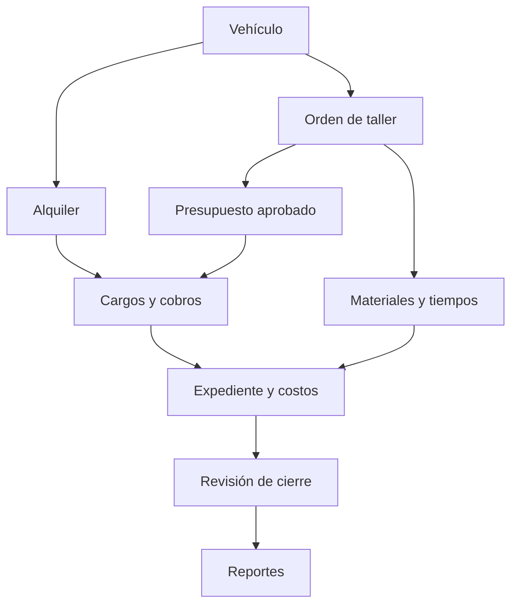
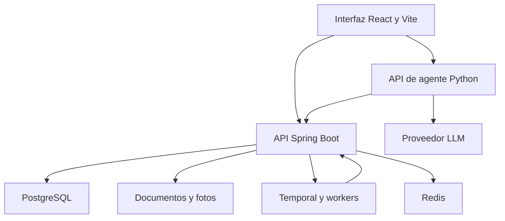

Este documento convierte las notas de la entrevista en una propuesta de sistema para renta de vehículos, mecánica y enderezado y pintura. Está dirigido al propietario y al equipo de desarrollo. La decisión principal es mantener un expediente por vehículo y una operación identificable por cada alquiler o ingreso al taller, relacionando sus costos, cobros, documentos y tiempos.

El objetivo es dejar de reconstruir costos revisando el libro diario día por día. Cada hecho se registra una vez y alimenta las distintas vistas. El agente consulta y opera mediante la misma API que usa la interfaz.

Fecha de elaboración: 3 de octubre de 2026. Estado: propuesta para validar con el negocio. Los Excel, contratos y presupuestos originales aún no fueron entregados; los campos y reglas siguientes son un diseño preliminar, no una descripción verificada de esos archivos. La investigación consultó documentación y repositorios oficiales; no se ejecutaron ni auditaron sus aplicaciones.

## 1 Alcance y hechos de la entrevista

**Confirmado por las notas:** la actividad principal es rentar carros; hay mecánica interna y servicios a terceros, además de enderezado y pintura. Usan tablas en Drive y un libro diario en Excel. Elaboran órdenes de servicio, presupuestos, listas de repuestos, cuadros de cuentas por cobrar y calendario de alquileres. Reciben información y acuerdos por WhatsApp. Al cerrar trabajos revisan nuevamente el libro diario porque algunos gastos quedan fuera. Quieren costos más precisos, tiempos de trabajo, comisiones, inventario, reportes y seguimiento de cada carro.

**Interpretaciones por validar:** “driver” se interpreta como Google Drive; “tempora” como Temporal; “línea” del calendario puede significar modelo o línea comercial. La referencia al ministerio parece corresponder a un cliente institucional de mantenimiento, pero no confirma un contrato vigente ni reglas especiales de contratación.

**Propuestas de este documento:** expedientes, reglas de costeo, importador con validación, permisos, arquitectura, indicadores y fases. Las condiciones comerciales y fiscales deberán definirse con las personas responsables.

| Prioridad | Alcance |
| - | - |
| P0 para operación piloto | Clientes, vehículos, expediente, libro diario operativo, Excel, órdenes, presupuestos versionados, costos, cuentas por cobrar, calendario, alquiler y devolución, consumos de repuestos, tiempos básicos, reportes y agente de consulta |
| P1 para completar operación | Compras y almacén completos, reglas de comisión, contratos con plantillas, automatizaciones duraderas, agente con acciones aprobadas, reportes programados |
| P2 para ampliar | WhatsApp integrado, facturación electrónica mediante proveedor o integración validada, mantenimiento preventivo avanzado, presupuestos operativos por área, análisis documental |
| Fuera del alcance inicial | Nómina completa, ERP contable general, portal público de reservas, GPS, pagos bancarios automáticos, valoración de daños por imagen y predicción de precios con IA |

El libro diario inicial será un registro operativo de ingresos, egresos y hechos relacionados. No se asumirá que equivale a un libro contable de partida doble. Si el negocio necesita contabilidad formal dentro del sistema, se añade un subproyecto con catálogo de cuentas, asientos, cierres y validación del contador.

## 2 Usuarios y permisos

| Rol propuesto | Operación permitida | Restricción |
| - | - | - |
| Propietario o gerencia | Costos, márgenes, aprobación de descuentos, excepciones y reportes generales | Reversiones y cambios de política siempre auditados |
| Administración o caja | Clientes, cobros, pagos, documentos y conciliación | No modifica costos históricos cerrados sin ajuste |
| Recepción o reservas | Ingreso de carros, reservas, entrega y devolución | No ve costo salarial individual ni aprueba su propio descuento excepcional |
| Jefe de taller | Diagnóstico, presupuestos, asignaciones y revisión de cierre | Cambios de alcance requieren aprobación registrada |
| Técnico | Tareas, tiempos, observaciones y solicitud de repuestos | Acceso a órdenes asignadas; no a toda la caja |
| Compras o almacén | Proveedores, recepciones, existencias y despachos | Ajustes de stock con motivo y autorización |
| Contador o consulta | Exportaciones y reportes autorizados | Consulta por defecto |
| Agente | Herramientas permitidas para el usuario que lo invoca | Nunca supera los permisos del usuario |

Una persona puede tener varios roles. El primer despliegue supone una empresa y una sede; registrar sede y centro de costo desde el inicio permite ampliarlo sin imponer una plataforma multiempresa.

## 3 Modelo operativo y trazabilidad

Un **vehículo** es una entidad permanente. Una **operación** es cada alquiler o cada orden de servicio. Una misma placa puede tener muchas operaciones a lo largo del tiempo; la placa sola no identifica a qué trabajo corresponde un gasto. Vehículos propios y vehículos de terceros comparten ficha, pero conservan propietario y tipo de relación.

El expediente presenta cronológicamente reservas, entradas y salidas físicas, diagnósticos, presupuestos, aprobaciones, trabajos, tiempos, materiales, gastos, cobros, facturas y documentos. Cada evento conserva autor, fecha del hecho, fecha de registro y operación de origen. Un gasto general debe ir a un centro de costo; no se inventa un vehículo para poder registrarlo.



### Flujo de taller

1. Recepción identifica cliente y vehículo, registra kilometraje, condición, accesorios, fotos y fecha de ingreso; genera orden de servicio.

2. Taller registra diagnóstico, tareas y repuestos previstos. El presupuesto puede prepararse antes del ingreso físico, asociado a la orden preliminar.

3. El motor determinista calcula costo estimado y precio propuesto. Gerencia revisa descuentos y administración genera la versión para el cliente.

4. Se registra aprobación o rechazo y su evidencia. Solo se ejecuta el alcance autorizado, salvo excepción documentada definida por el negocio.

5. Técnicos registran trabajo y tiempos; almacén despacha piezas; compras vincula adquisiciones directas con la orden.

6. Un hallazgo adicional genera suplemento o nueva versión; conserva presupuesto y autorización anteriores.

7. Antes de entrega se concilian tareas, consumos, costos externos, cargos y pagos. Cada costo se marca como incluido, adicional autorizado, interno o absorbido.

8. Se entrega el carro con acta y se cierra la orden operativa. Si queda crédito autorizado, la cuenta por cobrar permanece abierta.

Para la flota propia, la orden interna genera costo de mantenimiento y bloqueo de disponibilidad; no una venta ficticia al mismo negocio. Enderezado y pintura y mecánica usan el mismo motor de órdenes con catálogos y plantillas distintos.

### Flujo de renta

1. Se registra consulta y cliente desde recepción, incluyendo texto o evidencia de WhatsApp.

2. Se consulta disponibilidad por fecha y hora, categoría y vehículo.

3. Se crea reserva provisional con vencimiento; confirmarla exige cumplir la política comercial elegida.

4. Se genera contrato versionado, cargos y depósito de garantía separado del precio del alquiler.

5. En la entrega se registran conductor, kilometraje, combustible, accesorios, fotos y hora real.

6. Una extensión valida nuevamente disponibilidad, precio y contrato.

7. En la devolución se inspecciona y se documentan extras o daños antes de aprobar cargos.

8. Se liquida o deja saldo autorizado, se resuelve la garantía y se programa limpieza o taller antes de declarar el vehículo disponible.

**Estados separados:** reserva — borrador, provisional, confirmada, vencida, cancelada; alquiler — preparado, entregado, devuelto, cerrado; orden — recibida, diagnóstico, esperando aprobación, en trabajo, esperando repuestos, control de calidad, lista, entregada, cerrada o cancelada. El pago tiene su propio estado derivado del saldo. “Pagado” no significa “vehículo disponible”.

## 4 Requerimientos funcionales con entradas y salidas

Los identificadores RF se usarán también en pruebas y contratos API. P0, P1 y P2 corresponden al alcance de la sección 1.

| ID y prioridad | Requerimiento y entradas | Salidas esperadas |
| - | - | - |
| RF01 P0 | Clientes: persona o empresa, contacto, datos fiscales, conductores y evidencia | Ficha única, historial, alertas de duplicado |
| RF02 P0 | Vehículos: placa, VIN si existe, marca, línea, año, propiedad, kilometraje | Ficha, estado operativo y expediente |
| RF03 P0 | Ingreso y salida: orden o alquiler, hora, responsable, condición y fotos | Acta y evento trazable |
| RF04 P0 | Libro diario: fecha, concepto, categoría, monto, moneda, medio de pago, cuenta y operación | Movimiento numerado, filtros, saldo de caja y soporte |
| RF05 P0 | Importación: Excel o CSV, hoja, mapeo de columnas y política de duplicados | Vista previa, errores por fila, lote confirmado y conciliación |
| RF06 P0 | Orden de servicio: vehículo, cliente, área, diagnóstico, tareas y fecha objetivo | Orden identificada y tablero de avance |
| RF07 P0 | Presupuesto: cantidades, costos, horas, tarifas, descuentos y política de impuestos | Costo estimado, precio, margen y PDF versionado |
| RF08 P0 | Aprobación: versión, alcance, aprobador y evidencia | Versión autorizada, rechazada o suplemento pendiente |
| RF09 P0 | Costos: compra directa, consumo, tercero, horas o gasto asignado | Costo real y diferencia frente al estimado |
| RF10 P0 | Tiempos: técnico, tarea, inicio, pausa, fin y motivo | Horas activas, esperas y duración total |
| RF11 P0 | Revisión de entrega: tareas, costos, autorizaciones y saldo | Lista de pendientes y acta de cierre o excepción |
| RF12 P0 | Calendario: rango, placa, categoría, reservas y bloqueos | Filas por vehículo, ocupación y conflictos |
| RF13 P0 | Reserva y alquiler: cliente, vehículo, intervalo, tarifa, extras y vendedor | Reserva, alquiler, vencimiento y cargos |
| RF14 P0 | Devolución o extensión: hora, inspección, km, combustible y nuevas fechas | Disponibilidad recalculada, extras propuestos y liquidación |
| RF15 P0 | Cargos y cobros: documento, vencimiento, abonos y aplicación de pagos | Saldo por documento, cliente y operación |
| RF16 P0 | Inventario básico: artículo, unidad, saldo inicial, entrada, consumo y devolución | Existencia y costo asociado a orden |
| RF17 P1 | Compras: proveedor, solicitud, autorización, recepción y factura | Orden de compra, recepción, costo y obligación de pago |
| RF18 P1 | Comisión: vendedor, base elegible, tasa, vigencia, devoluciones | Comisión calculada, aprobada, pagada o revertida |
| RF19 P1 | Contratos: plantilla, versión, partes, condiciones y firma adjunta | Documento generado e historial de aceptación |
| RF20 P0 | Reportes: fechas, área, vehículo, cliente y estado | Dashboard, detalle comprobable y exportación |
| RF21 P1 | Automatización: evento, destinatario autorizado, plazo y plantilla | Tarea programada, borrador o envío auditado |
| RF22 P0 y P1 | Agente: pregunta o instrucción, identidad y contexto | Respuesta con fuentes, propuesta o acción confirmada |
| RF23 P0 | Administración: usuarios, roles, catálogos, políticas y auditoría | Accesos controlados y configuraciones versionadas |
| RF24 P2 | Presupuesto operativo: área, periodo, categoría y monto autorizado | Plan frente a comprometido y ejecutado |
| RF25 P2 | Integraciones: mensajería, sistema fiscal o documentos externos | Eventos correlacionados y estados de integración |

El RF07 resuelve el presupuesto que se envía al cliente. El RF24 resuelve una necesidad distinta: cuánto puede gastar el negocio en un periodo. Se propone por la ambigüedad de “manejar presupuesto”; debe validarse si también lo necesitan.

## 5 Historias de usuario y aceptación

Cada historia identifica actor, intención y beneficio. Los criterios son comprobables y deben convertirse en pruebas funcionales.

| Historia | Como usuario quiero | Criterio de aceptación |
| - | - | - |
| HU01 RF01 | Como recepción, localizar al cliente para reutilizar sus datos | Al buscar teléfono o identificación se muestran coincidencias antes de crear; una fusión conserva relaciones |
| HU02 RF02 | Como administrador, distinguir carros propios y de clientes para asignar costos | La ficha muestra propietario y todas sus operaciones sin mezclar saldos |
| HU03 RF03 | Como recepción, dar entrada rápidamente para iniciar seguimiento | Con cliente, vehículo y motivo se genera folio único; datos pendientes aparecen señalados |
| HU04 RF04 | Como caja, registrar un gasto pequeño para que no se pierda | Exige operación o centro de costo; aparece inmediatamente en diario y expediente |
| HU05 RF05 | Como administración, cargar mis Excel para evitar digitarlos | La vista previa muestra filas válidas, rechazadas y duplicadas; ninguna se publica antes de confirmar |
| HU06 RF05 | Como administración, repetir una importación sin duplicar pagos | El mismo lote no crea movimientos adicionales; las coincidencias ambiguas requieren resolución |
| HU07 RF06 | Como jefe de taller, asignar tareas para conocer qué falta | Cada tarea tiene responsable y estado; finalizar una no cierra las demás |
| HU08 RF07 | Como presupuestador, calcular por reglas para explicar el precio | Las mismas cantidades y la misma versión de tarifas producen el mismo resultado |
| HU09 RF08 | Como administrador, guardar aprobación para no discutir el alcance | El presupuesto aprobado queda inmutable; cambios producen nueva versión o suplemento |
| HU10 RF09 | Como compras, cargar un repuesto inesperado al trabajo correcto | Se registra su destino y aparece como pendiente de clasificar para cobro |
| HU11 RF10 | Como técnico, registrar tiempo para comparar trabajo real y previsto | Pausas no suman tiempo activo; ediciones conservan motivo y autor |
| HU12 RF11 | Como administración, revisar pendientes antes de entregar | Un costo sin disposición comercial impide cierre ordinario; excepción exige responsable y motivo |
| HU13 RF12 | Como reservas, ver ocupación futura para programar alquileres | Cada fila muestra placa y barras con fechas, cliente y pago; incluye taller y limpieza |
| HU14 RF13 | Como reservas, confirmar sin alquilar dos veces el mismo carro | Dos confirmaciones concurrentes incompatibles producen un éxito y un conflicto |
| HU15 RF13 | Como ventas, registrar lo acordado por WhatsApp para conservar evidencia | Texto o archivo queda ligado a la reserva, con fecha y autor del registro |
| HU16 RF14 | Como recepción, extender un alquiler para atender al cliente | Si choca con otro compromiso, se rechaza la extensión y se muestran alternativas |
| HU17 RF14 | Como recepción, documentar la devolución para acordar extras | La inspección compara salida y retorno; daños generan propuesta de cargo, no cobro automático |
| HU18 RF15 | Como caja, aplicar un abono para conocer el saldo | Un cargo de 500 con abono de 200 muestra 300 pendientes, con historial de aplicación |
| HU19 RF15 | Como administración, controlar vencidos para cobrar a tiempo | La antigüedad depende del vencimiento y fecha de corte; cancelar una reserva no borra deuda |
| HU20 RF16 | Como almacén, entregar piezas para controlar consumo | El despacho reduce stock y carga costo a la orden una sola vez; devolución lo revierte |
| HU21 RF17 | Como compras, recibir parcialmente para conocer lo pendiente | Recibir 3 de 5 unidades aumenta stock en 3 y deja 2 pendientes |
| HU22 RF18 | Como gerencia, calcular comisión para pagar con criterio uniforme | La regla aplicada queda versionada; un reembolso ajusta la base sin duplicar liquidaciones |
| HU23 RF19 | Como recepción, generar contrato para reutilizar datos | El PDF conserva partes y condiciones de esa versión aunque cambie luego la ficha |
| HU24 RF20 | Como dueño, consultar margen por carro para decidir | El indicador permite abrir los ingresos y costos que forman el total |
| HU25 RF20 y RF21 | Como dueño, recibir un reporte periódico para revisar la operación | El corte y filtros quedan registrados; un reintento no genera envíos duplicados |
| HU26 RF22 | Como dueño, preguntar cuánto costó un carro para no buscar en cuadros | El agente identifica vehículo y operación y devuelve desglose con referencias y fecha de corte |
| HU27 RF22 | Como caja, pedir al agente registrar un gasto para ahorrar pasos | Presenta importe y destino; tras confirmación persiste una vez y devuelve el folio |
| HU28 RF23 | Como dueño, restringir acciones para mantener control | Un técnico no puede leer caja ni mediante URL directa ni mediante el agente |
| HU29 RF24 | Como gerencia, comparar plan y gasto para controlar presupuesto | Muestra presupuestado, comprometido y ejecutado sin sumar dos veces una compra recibida |
| HU30 RF25 | Como administración, conectar herramientas externas para evitar recaptura | Un evento duplicado se reconoce y su error puede recuperarse sin repetir el negocio |

HU29 y HU30 son ampliaciones propuestas; el resto responde a necesidades expresadas o controles necesarios para ejecutarlas.

## 6 Reglas de costos y precios

**Costo, precio, cargo, cobro y salida de dinero son conceptos distintos.** Comprar inventario no significa consumirlo; pagar una factura no vuelve a generar el costo; incluir un repuesto en presupuesto no significa haberlo comprado ni utilizado. Los reportes deben mostrar claramente cuál magnitud presentan.

### Presupuesto determinista de taller

Se propone un catálogo de tareas por área: mecánica, preparación, enderezado, pintura, armado y control de calidad. Cada tarea puede tener horas estándar, tarifa comercial, costo por hora, unidad, categoría de vehículo y complejidad definida. Pintura agrega paneles o superficie, materiales y consumos estándar calibrados por el taller. Las reglas iniciales deben salir de trabajos reales y validación del encargado.

- Costo estimado de materiales = suma de cantidad prevista por costo unitario vigente.

- Costo estimado de mano de obra = suma de horas previstas por costo interno por hora.

- Costo estimado total = materiales + mano de obra + servicios externos + indirectos asignados.

- Precio antes de impuestos = líneas a tarifa comercial menos descuentos autorizados.

- Si se usa margen objetivo como alternativa: precio = costo estimado / (1 − margen objetivo).

- Si se usa recargo sobre costo como alternativa: precio = costo estimado × (1 + recargo).

**No aplicar ambos métodos simultáneamente.** El cálculo guarda política, tarifas, redondeo y fecha. Los impuestos se configuran después de validar el tratamiento aplicable; este documento no establece tasas ni reglas fiscales.

Ejemplo didáctico, sin impuestos: materiales 120 + trabajo 80 + tercero 30 + indirectos 20 = costo estimado 250. Un margen objetivo de 25 % produce precio 333.33 y margen aproximado 83.33. Un recargo de 25 % produce 312.50; no equivale a margen de 25 %. Si los costos finales suben a 280 y el precio sigue en 333.33, el margen queda en 53.33, aproximadamente 16 %. Un costo extra puede reducir margen sin convertirse automáticamente en cargo al cliente.

### Costo real y política de consumo

Costo real de la orden = materiales consumidos netos de devoluciones + horas activas aprobadas por costo interno congelado + trabajos externos + gastos directos + indirectos asignados bajo política explícita.

Propuesta inicial de inventario: promedio ponderado móvil para artículos intercambiables y costo específico para compras directas identificadas. Validar con administración antes de implementar. Un repuesto tiene una ruta de costo: consumo desde almacén o compra directa; no ambas. Material que trae el cliente conserva custodia y uso, separado del costo de adquisición propio.

Los indirectos solo se añaden con una base definida, por ejemplo horas de trabajo. Si no existe información fiable, reportar margen directo y marcar indirectos pendientes; no llamarlo utilidad neta.

### Controles para que no se escapen gastos

1. Todo costo tiene operación o centro de costo, documento de origen y categoría.

2. Toda compra y consumo destinado a carro exige operación concreta, no solo placa.

3. La revisión muestra costos sin cargo asociado y costos aún sin decisión comercial.

4. Se resuelven como incluidos, adicionales aprobados, no cobrables, garantía o gasto interno.

5. El cierre conserva una fotografía de costos y cargos. Un gasto tardío crea ajuste auditado; no desaparece por haber cerrado.

6. Compras pendientes o servicios recibidos sin factura aparecen como provisionales. Se evita presentar el margen como definitivo mientras existan.

### Reglas complementarias

Reservas y bloqueos usan intervalos con fecha y hora, incluidos tiempos de limpieza. Confirmación y extensión validan concurrencia en PostgreSQL. La disponibilidad nunca depende exclusivamente de caché.

Garantía reembolsable y anticipo de alquiler se registran por separado. La garantía no se muestra como venta; su aplicación a daños o saldo requiere liquidación y autorización. Los pagos admiten varios medios y aplicaciones parciales. Transferencias entre cuentas propias no cuentan como ingreso comercial.

Comisiones: definir si la base es facturación o cobro, qué conceptos excluye, quién recibe, si admite reparto y cómo trata descuentos y reembolsos. Propuesta para validar: base neta efectivamente cobrada, excluyendo garantías y partidas no elegibles. No existe una tasa acordada en la entrevista.

Las órdenes internas de flota conservan costo y tiempo fuera de servicio. La rentabilidad por vehículo cruza esos costos con alquileres mediante una regla de periodo; no los duplica en cada renta.

## 7 Importación de los Excel y transición

Primero se necesita una copia representativa de cada libro: diario, mecánica, enderezado y pintura, facturación o cuentas por cobrar, reservas, comisiones e inventario. Incluya un trabajo cerrado y otro abierto. Se requieren sus columnas, fórmulas, hojas ocultas relevantes, códigos y relación entre cuadros; no se ha verificado todavía si comparten identificadores.

**Flujo de la interfaz:** subir archivo → elegir tipo y hoja → mapear columnas → validar → resolver relaciones y duplicados → comparar totales → confirmar lote → descargar resultado.

| Control | Comportamiento propuesto |
| - | - |
| Archivo | XLSX y CSV inicialmente; XLS antiguo se convierte por un proceso controlado; no ejecutar macros |
| Procedencia | Conservar archivo, hash, hoja, fila, autor y fecha de importación |
| Mapeo | Plantilla guardada por formato; permite fechas y separadores decimales locales |
| Relaciones | Resolver cliente, placa y operación; las coincidencias ambiguas se quedan en revisión |
| Duplicados | Hash del archivo para repetición exacta y clave de origen para registros; fecha más monto no basta para borrar coincidencias |
| Fórmulas | Mostrar fórmulas o valores ausentes como incidencia; no confiar en resultados de Excel sin reconciliación |
| Validación | Fechas válidas, importes, categorías, sumas por medio de pago y saldos |
| Publicación | Transacción por lote acotado; ningún registro rechazado se publica silenciosamente |
| Corrección | Lote no confirmado se descarta; lote publicado se revierte con trazabilidad y validación de dependencias |

**Evitar doble conteo entre libros:** si un cobro aparece en diario, reserva y cuentas por cobrar, se importa un pago con sus relaciones y evidencia de las tres fuentes. No se importan tres cobros. Si el presupuesto contiene repuestos previstos, eso no genera costo real.

Para la puesta en marcha, definir fecha de corte. Migrar maestros, reservas futuras, órdenes abiertas, stock contado y saldos por documento. El histórico puede incorporarse luego en lotes reconciliados. Durante el piloto se comparan resultados; al corte final se define un único registro autoritativo y se evita la escritura indefinida en ambos sistemas.

## 8 Pantallas y reportes

| Pantalla | Contenido y acciones principales |
| - | - |
| Inicio | Entregas y devoluciones de hoy, carros en taller, saldos vencidos y pendientes de cierre |
| Calendario de renta | Filas con línea, placa y vehículo; barras con fechas y horas, cliente, reserva y estado de pago; filtros y detalle |
| Expediente del vehículo | Línea temporal y pestañas de alquileres, taller, gastos, documentos e indicadores |
| Recepción rápida | Buscar cliente y placa, crear operación, registrar entrada y adjuntar fotos |
| Taller | Tablero por estado, área, responsable, tareas y fecha prometida |
| Presupuesto | Editor por líneas, costos internos, precio para cliente, versiones y suplementos |
| Libro diario | Tabla filtrable, alta rápida, comprobantes, medio de pago e importación |
| Cuentas por cobrar | Saldos, vencimientos, abonos y estado de cuenta por cliente |
| Compras e inventario | Solicitudes, recepciones, existencias, consumos y devoluciones |
| Tiempos | Inicio, pausa y fin por tarea; aprobación de correcciones |
| Clientes y contratos | Datos, vehículos, operaciones, documentos y condiciones vigentes |
| Reportes | Filtros, definiciones, detalle y exportaciones |
| Asistente | Chat con contexto del carro abierto, referencias y tarjetas de confirmación |
| Configuración | Roles, catálogos, tarifas, reglas, plantillas y auditoría |

La interfaz debe funcionar en computadora y permitir recepción y tiempos desde celular. El calendario también tendrá vista de lista para pantallas pequeñas y navegación por teclado. El color se acompaña de etiqueta; no se usa como único indicador.

| Reporte | Cálculo o contenido |
| - | - |
| Diario operativo | Entradas y salidas de dinero por fecha efectiva, cuenta, medio y área |
| Costo por orden | Estimado frente a real, desglosado por materiales, trabajo, terceros e indirectos |
| Costos sin resolver | Partidas sin operación o sin disposición comercial |
| Cuentas por cobrar | Saldo abierto a fecha de corte; no vencido, 1–30, 31–60, 61–90 y más de 90 días |
| Ocupación | Horas alquiladas / horas rentables del periodo; mostrar por separado horas bloqueadas |
| Margen por vehículo | Ingresos reconocidos bajo política acordada menos costos asignados; separar flujo de caja |
| Tiempos de taller | Tiempo de permanencia, horas activas y horas de espera; causas y responsable |
| Desviación de tarea | Horas reales menos horas previstas; retrabajo identificado aparte |
| Inventario | Existencia, movimientos, consumos por orden y mínimos |
| Comisiones | Base elegible, tasa, ajustes, aprobaciones y pagos |
| Resumen gerencial | Rentas, taller, cobros, gastos, vencidos y pendientes con vínculos al detalle |

Los reportes conservan fecha de corte, zona horaria, filtros y política de cálculo. Cuando falta un dato, muestran “sin registrar”; no lo convierten en cero. La productividad no se infiere solo del tiempo entre ingreso y salida del carro.

## 9 Arquitectura propuesta

Se propone un **monolito modular en Spring Boot**, acompañado de un servicio Python para IA. Mantiene transacciones del negocio en una sola aplicación y evita implementar las mismas reglas en Java y Python.



El navegador se conecta por un acceso HTTPS común que enruta hacia cada API. Ambas validan identidad; Python propaga el contexto autorizado al backend. Spring Boot es el dueño de clientes, flota, órdenes, dinero, inventario, reservas y cálculos.

| Componente | Responsabilidad y decisión |
| - | - |
| React con Vite y TypeScript | Formularios, calendario y dashboards; Vite dispone de plantilla React y TypeScript [S10] |
| TanStack Table | Tablas filtrables del diario e importación; su repositorio ofrece adaptadores para React y licencia MIT [S5] |
| UI y formularios | Propuesta: Tailwind, shadcn/ui, React Hook Form, Zod y TanStack Query; validar compatibilidad y fijar versiones al iniciar |
| Spring Boot | API de negocio, seguridad, validaciones y transacciones; módulos por dominio [S11] |
| Python con FastAPI | Servicio de chat, contratos tipados de herramientas y adaptador LLM [S12] |
| LangGraph | Grafo pequeño para resolver entidades, consultar, proponer, esperar confirmación y verificar; permite estado e intervención humana [S8] |
| PostgreSQL | Fuente de verdad del negocio, auditoría, importaciones y outbox |
| Temporal | Expiraciones, aprobaciones con plazos y trabajos duraderos; llamadas externas dentro de Activities [S7] |
| Redis | Caché descartable y límites de uso; introducir cuando haya beneficio medible [S13] |
| Almacenamiento de objetos | PDFs, Excel y fotos; metadatos y permisos en PostgreSQL, acceso temporal autorizado |
| Operación | Docker Compose, proxy HTTPS, migraciones Flyway y telemetría; propuestas sujetas al entorno disponible |

### Separación de coordinación

**Spring Boot** decide si una operación es válida y la confirma en una transacción. **LangGraph** coordina el razonamiento del chat. **Temporal** maneja esperas y recuperación de procesos del negocio. Cada uno tiene un estado diferente; Temporal no almacena el saldo autoritativo y LangGraph no decide cuánto cuesta una reparación.

El MVP puede operar con Spring Boot, PostgreSQL y Python sin Temporal ni Redis en el camino crítico. Temporal se incorpora en la fase de automatización y Redis solo para caché o límites. Si el equipo necesita reducir infraestructura, una tabla de tareas programadas y un worker inicial cubren los trabajos simples; migrar a Temporal cuando haya aprobaciones prolongadas y varios efectos recuperables.

**No iniciar microservicios por módulo, Kubernetes, Neo4j ni una base vectorial.** Las preguntas de trazabilidad y saldos se resuelven mediante consultas estructuradas. Si luego se consultan cláusulas de contratos o manuales extensos, evaluar búsqueda documental por separado.

### Consistencia y fallos

La transacción de negocio escribe el cambio y un evento outbox. Un publicador entrega el evento al worker con identificador estable. Los consumidores guardan eventos procesados y admiten entregas repetidas.

Temporal requiere idempotencia en las Activities que produzcan efectos: un reintento no debe repetir un cargo ni un envío [S7]. Para aprobaciones, el registro autoritativo está en PostgreSQL; un evento despierta el workflow. Si la señal se retrasa, el worker vuelve a consultar el estado.

No mantener una transacción SQL abierta mientras se llama al LLM. Si la IA cae, formularios, reservas y caja siguen funcionando. Si Redis cae, la validación financiera y la exclusión de reservas siguen en PostgreSQL. Si falla mensajería, el envío queda pendiente con estado comprobable.

Las reservas y bloqueos confirmados comparten una tabla de ocupación, con exclusión por vehículo e intervalo mediante rangos y GiST. PostgreSQL documenta restricciones para impedir solapamientos [S9]. Reservas vencidas se liberan con transición explícita; una condición que dependa del reloj no sustituye ese proceso. Un retraso real de devolución genera conflicto operativo y alerta, no se oculta para satisfacer la agenda.

## 10 Modelo de datos y responsabilidades

| Grupo | Entidades y relaciones principales |
| - | - |
| Identidad | usuario, rol, permiso, sede, centro_costo |
| Clientes | cliente, contacto, perfil_fiscal, conductor, evidencia_contacto |
| Vehículos | vehiculo, propietario, lectura_odometro, inspeccion, evento_vehiculo |
| Operaciones | operacion como identidad común; alquiler y orden_servicio como tipos con campos propios |
| Renta | reserva, ocupacion_vehiculo, alquiler, tarifa_version, cargo_alquiler, inspeccion_entrega |
| Taller | orden_servicio, tarea, asignacion, tiempo_trabajo, diagnostico |
| Presupuestos | presupuesto, version_presupuesto, linea_presupuesto, aprobacion, suplemento |
| Costos | costo_operacion, asignacion_costo, clasificacion_comercial, tarifa_costo_version |
| Dinero | cargo, documento_cobro, vencimiento, pago, aplicacion_pago, garantia, movimiento_caja, reverso |
| Compras | proveedor, solicitud_compra, orden_compra, recepcion, documento_proveedor |
| Inventario | articulo, unidad, almacen, movimiento_stock, consumo_orden |
| Comisiones | regla_comision_version, devengo_comision, liquidacion_comision |
| Documentos | plantilla_version, documento_generado, adjunto y hash |
| Integración | importacion, fila_importada, registro_origen, evento_outbox, entrega_integracion |
| IA | conversacion, ejecucion_agente, propuesta_accion, aprobacion_accion, tool_execution |
| Control | auditoria, clave_idempotencia, reporte_generado, politica_version |

Cada costo puede distribuirse entre operaciones mediante asignaciones cuya suma no exceda el costo original. Cada pago puede aplicarse a varios documentos; la suma aplicada no excede el pago disponible. Garantías, anticipos y saldos a favor tienen tratamiento explícito.

El diario es una vista operativa de hechos persistidos, no un segundo sistema donde se vuelven a escribir los datos. Usar identificador estable, folio legible, created_at, occurred_at, actor y versión. Los importes usan decimal exacto y moneda. Las fechas se guardan con zona o en UTC y se presentan en America/El_Salvador; el corte diario utiliza esa zona.

Spring Boot tiene acceso de escritura al esquema de negocio. El servicio Python accede a esos datos exclusivamente por API; sus conversaciones y checkpoints viven en un esquema separado con permisos propios. Temporal usa almacenamiento y credenciales propios. Documentos originales se conservan sin sobreescribir versiones aprobadas.

## 11 Contratos API y trazabilidad de requisitos

Todas las rutas siguientes llevan prefijo `/api/v1`. Son contratos propuestos para especificar en OpenAPI durante la fase 01. GET consulta; POST crea o ejecuta una transición; PATCH modifica borradores. Los registros confirmados se corrigen mediante operaciones explícitas, no con borrado genérico.

| Requisitos | Rutas principales | Resultado |
| - | - | - |
| RF01 | GET y POST /customers; GET y PATCH /customers/{id} | Cliente y versión |
| RF02 | GET y POST /vehicles; GET /vehicles/{id}/timeline | Vehículos y expediente paginado |
| RF03 | POST /operations/{id}/inspections; POST /operations/{id}/handover | Inspección o entrega |
| RF04 | GET /daily-ledger; POST /expenses; POST /cash-transfers | Diario o movimiento identificado |
| RF05 | POST /imports; PUT /imports/{id}/mapping; POST /imports/{id}/validate; GET /imports/{id}/preview; POST /imports/{id}/commit | Lote, incidencias y resultado |
| RF06 | POST /work-orders; GET /work-orders/{id}; POST /work-orders/{id}/tasks; POST /tasks/{id}/assign; POST /tasks/{id}/transition | Orden y avance |
| RF07 | POST /work-orders/{id}/estimates; POST /estimates/{id}/calculate; POST /estimates/{id}/versions | Totales calculados y versión |
| RF08 | POST /estimates/{id}/approvals; POST /estimates/{id}/supplements | Evidencia y alcance autorizado |
| RF09 | GET /operations/{id}/costs; POST /costs/{id}/allocations; POST /costs/{id}/disposition | Costos y tratamiento comercial |
| RF10 | POST /tasks/{id}/time-entries; POST /time-entries/{id}/stop; POST /time-entries/{id}/corrections | Tiempo y auditoría |
| RF11 | GET /work-orders/{id}/closure-check; POST /work-orders/{id}/close | Pendientes o cierre |
| RF12 | GET /availability; GET /calendar; POST /vehicle-blocks | Intervalos y disponibilidad |
| RF13 | POST /reservations; POST /reservations/{id}/confirm; POST /reservations/{id}/cancel; POST /rentals | Reserva o alquiler |
| RF14 | POST /rentals/{id}/checkout; POST /rentals/{id}/extensions; POST /rentals/{id}/return; POST /rentals/{id}/close | Estado, liquidación y conflictos |
| RF15 | POST /charges; POST /billing-documents; POST /payments; POST /payments/{id}/allocations; GET /receivables | Documentos, aplicaciones y saldo |
| RF15 | POST /guarantees; POST /guarantees/{id}/settlements; POST /payments/{id}/reversals | Garantía o reverso auditado |
| RF16 | GET /inventory; POST /stock-receipts; POST /work-orders/{id}/consumptions; POST /consumptions/{id}/returns | Existencias y costo |
| RF17 | POST /purchase-requests; POST /purchase-orders; POST /purchase-orders/{id}/receipts | Compras y recepciones |
| RF18 | POST /commission-rules; POST /commissions/calculate; POST /commission-settlements | Cálculo versionado y liquidación |
| RF19 | POST /contracts; POST /contracts/{id}/generate; POST /contracts/{id}/acceptance | Contrato y evidencia |
| RF20 | GET /reports/{type}; POST /report-jobs; GET /jobs/{id} | Datos o archivo generado |
| RF21 | POST /automation-rules; GET /automation-runs; POST /automation-runs/{id}/retry | Programación y ejecución |
| RF22 | POST /agent/runs; GET /agent/runs/{id}; POST /agent/actions/{id}/confirm | Ejecución, propuesta o resultado |
| RF23 | GET /audit-events; GET y POST /users; POST /role-assignments; PATCH /settings/{key} | Configuración autorizada |
| RF24 | POST /operating-budgets; GET /operating-budgets/{id}/execution | Plan y ejecución |
| RF25 | POST /integrations/{provider}/webhooks; GET /integration-deliveries | Recepción deduplicada y estado |

Para las tareas usar transiciones iniciar, pausar, reanudar y finalizar; una pausa cierra el tramo activo. No implementar un cronómetro exclusivamente en el navegador.

**Contrato común:** identidad autenticada; alcance por rol y sede; `Idempotency-Key` para comandos reintentables; `expectedVersion` para cambios concurrentes; `requestId` para correlación. Una clave repetida con otro cuerpo es conflicto, no una nueva operación.

Respuesta exitosa: identificador, estado, versión, fecha y vínculos a los registros. Error: código estable, mensaje, campos afectados, requestId y si puede reintentarse. Usar 403 para permiso, 409 para conflicto de versión o reserva y 422 para regla de negocio. Exportaciones e importaciones grandes devuelven 202 con jobId.

Pruebas de contrato deben comprobar correspondencia entre API, cliente TypeScript y herramientas Python. No basta generar rutas CRUD: las transiciones de confirmar, aplicar, cerrar, devolver y revertir contienen las reglas del negocio.

## 12 Agente con herramientas operativas

El agente debe poder consultar el estado completo y ejecutar las acciones habilitadas. Esto se implementa exponiendo **herramientas de negocio tipadas**, no dando al modelo una herramienta HTTP arbitraria con todos los endpoints.

Grafo propuesto: interpretar → resolver entidades → consultar evidencia → decidir si hace falta acción → preparar propuesta → confirmar cuando corresponda → ejecutar → verificar → responder. La validación de importes, permisos y estados es código determinista.

**Un agente inicial es suficiente.** Consultar renta, taller y cobranza son grupos de herramientas del mismo agente. Separar agentes solo cuando existan permisos, objetivos o evaluaciones distintos que justifiquen esa complejidad.

| Herramienta | Entradas y salida | Permiso y comportamiento |
| - | - | - |
| buscar_vehiculo | Placa o texto → coincidencias e IDs | vehicles.read; no elige entre coincidencias ambiguas |
| consultar_expediente | vehicleId, fechas → eventos con operaciones | vehicles.read; filtra datos restringidos |
| consultar_costos | operationId, corte → estimado, real y pendientes | costs.read; totales calculados por backend |
| consultar_disponibilidad | Intervalo y categoría → vehículos e intervalos | rentals.read; consulta autoritativa antes de confirmar |
| consultar_cartera | Cliente o filtros → documentos y saldos | receivables.read; limita volumen y datos personales |
| crear_presupuesto_borrador | Orden y líneas → borrador calculado | estimates.write; no aprueba su propia propuesta |
| proponer_reserva | Cliente, vehículo y fechas → resumen y conflictos | reservations.write; confirmación vuelve a validar |
| registrar_gasto | Operación, concepto, monto, medio y soporte → folio | expenses.write; requiere confirmación del resumen |
| aplicar_pago | Pago, documentos e importes → saldo resultante | payments.allocate; confirmación y control de concurrencia |
| registrar_tiempo | Tarea y tramos → tiempo registrado | times.write; restringido a asignación autorizada |
| revisar_cierre | Orden → lista de pendientes y evidencias | workorders.read; no sustituye inspección física |
| generar_reporte | Tipo, filtros y corte → datos o jobId | reports.read; archivo con filtros y procedencia |

Agregar herramientas para todas las capacidades necesarias del catálogo API conforme se implementen; la lista anterior define el núcleo. Las operaciones administrativas, integraciones y reversiones tendrán permisos específicos y no se habilitan por defecto al agente.

Cada contrato de herramienta especifica JSON Schema de entrada y salida, rol, límites, timeout, reintentos, efecto, idempotencia y auditoría. Propuesta inicial: lecturas de 10 segundos con un reintento transitorio; escrituras de 20 segundos, sin reintento ciego. Si la respuesta se pierde, consultar el resultado por clave de idempotencia antes de repetir.

La propuesta de acción conserva usuario, parámetros exactos, hash, versión y expiración. La confirmación solo vale para esa propuesta; si cambia monto, vehículo o alcance, se presenta de nuevo. Se verifica autorización nuevamente al ejecutar.

**Ejemplos:**

- “¿Qué le hemos gastado al P123456 desde que entró?” Resuelve placa, distingue ingresos al taller y pide cuál si hay ambigüedad; devuelve desglose y folios.

- “¿Qué carros tengo libres del viernes a las 8 al domingo a las 6?” Resuelve fechas y zona, consulta bloqueos y muestra intervalos.

- “Registrá 35 de pintura en la orden 104.” Solicita medio de pago o soporte si falta, muestra destino y monto, y registra tras confirmación.

- “¿Puedo entregar este carro?” Presenta tareas, costos sin resolver y saldo; la decisión física corresponde al responsable.

Las respuestas indican corte y fuentes del sistema. Los textos de WhatsApp, documentos y celdas importadas son datos, nunca instrucciones de sistema. No hay SQL libre, shell ni acceso directo del modelo a credenciales.

Interfaces de proveedor: `LLMProvider` para respuesta estructurada y tool calling; `DocumentStore` para adjuntos; `MessagingProvider` para futuros envíos. Cambiar proveedor requiere evaluación de herramientas y salidas, no solo cambiar una URL.

Límites propuestos: 10 llamadas a herramientas por turno y 60 segundos antes de devolver estado o pedir datos. Registrar modelo, tokens, costo estimado, herramientas, latencias y resultado. No guardar documentos personales completos en trazas.

Evaluación inicial: 40 casos revisados por negocio con consultas, entidades ambiguas, permisos, importes y reintentos. Criterios: ninguna acción no autorizada, ningún cargo duplicado y coincidencia exacta de cifras con API. La fluidez del texto no compensa errores de saldo.

## 13 Automatizaciones y requisitos no funcionales

| Proceso | Disparador, espera y resultado |
| - | - |
| Reserva provisional | Creación → espera hasta vencimiento → confirma estado actual → libera si procede |
| Presupuesto | Envío registrado → espera aprobación o vencimiento → recordatorio o tarea |
| Entrega pendiente | Orden lista → revisión de cierre → tareas para resolver costos y documentos |
| Cobranza | Vencimiento → saldo actual → propuesta de recordatorio según política |
| Reporte gerencial | Corte programado → generar datos → guardar archivo → enviar si canal y destinatario están autorizados |
| Importación grande | Archivo validado → procesar lote → publicar resultado recuperable |

Primero se generan tareas o borradores. Envíos externos automáticos se habilitan cuando el negocio configure canal, destinatarios, plantillas y política. La autorización humana puede ser una política previamente aprobada; no exige un clic para cada tarea rutinaria.

| Requisito | Objetivo verificable propuesto |
| - | - |
| Seguridad | Backend autoriza cada acción; tokens limitados; secretos fuera del código |
| Auditoría | Actor, momento, origen, antes y después o evento de ajuste; sin borrado ordinario de movimientos confirmados |
| Exactitud | Dinero decimal; redondeo explícito; mismo cálculo en formulario, agente y reporte |
| Concurrencia | No doble reserva; no doble aplicación de pago; consumo no excede stock salvo política explícita |
| Rendimiento | En piloto con 10 usuarios concurrentes: p95 menor a 2 s para consultas ordinarias; exportaciones grandes asíncronas |
| Recuperación | Meta inicial a aprobar: RPO 24 h y RTO 4 h; ensayar restauración de BD y archivos antes de producción |
| Disponibilidad | Caída de IA no bloquea negocio; fallos de integración quedan pendientes y visibles |
| Privacidad | Ocultar datos personales por rol; política de retención acordada y acceso temporal a adjuntos |
| Observabilidad | requestId compartido entre UI, API, worker y herramienta; alertas de fallos persistentes |
| Usabilidad | Recepción rápida en celular; filtros guardados; errores por campo y accesibilidad básica |
| Mantenibilidad | Migraciones, OpenAPI, versiones fijadas y pruebas de reglas críticas |
| Portabilidad | Compose reproducible, copias exportables y separación de proveedor LLM |

Los objetivos de capacidad y recuperación son supuestos para dimensionar, no garantías medidas. El taller debe validar cuántos carros, usuarios, movimientos y fotos genera.

**Despliegue propuesto:** frontend estático, API Java, servicio IA Python, PostgreSQL y almacenamiento de objetos; después worker y servicio Temporal, y Redis si se justifica. Base de datos y paneles administrativos sin exposición pública directa. Entornos separados de desarrollo, prueba y producción; datos anonimizados en pruebas.

CI propuesta: compilación, análisis de dependencias, pruebas unitarias de cálculo, integración PostgreSQL con Testcontainers, contratos API y recorridos E2E con Playwright. Rollback del código debe ser compatible con migraciones; los datos confirmados se corrigen con ajustes, no restaurando indiscriminadamente una copia antigua.

### Estructura del repositorio

```text
apps/web
services/core-api
services/agent-api
workers/business-workflows
contracts/openapi
contracts/tools
infra/compose
infra/observability
docs/requirements
docs/decisions
docs/phases
tests/acceptance
```

Dentro de core-api: customers, fleet, rental, workshop, costing, inventory, finance, reporting y audit, cada uno con API, aplicación, dominio y persistencia. En agent-api: graph, tools, schemas, providers y evaluations. El código generado de clientes se deriva de contratos versionados.

## 14 Proyectos y herramientas para reutilizar

La investigación sirve para elegir referencias y componentes. **No se verificó una aplicación lista que reúna este flujo exacto.** Las referencias de ERP ayudan a estudiar relaciones y procesos; los componentes técnicos sí pueden incorporarse tras comprobar versión, licencia y pruebas. No conviene ensamblar fragmentos de varios ERP sin un modelo de datos coherente.

| Referencia oficial | Qué estudiar o reutilizar | Decisión propuesta |
| - | - | - |
| [ERPNext](https://github.com/frappe/erpnext) | Relaciones entre ventas, inventario, contabilidad, activos y tiempos; licencia GPL-3.0 [S1] | Evaluar como alternativa de producto completo; estudiar sus flujos si se conserva el stack propio |
| [Cotizaciones de ERPNext](https://docs.frappe.io/erpnext/quotation) | Estructura de cotización y condiciones [S2] | Referencia funcional para RF07; la regla específica del taller se desarrolla |
| [OCA fleet](https://github.com/OCA/fleet) | Inspecciones de entrada y salida, combustible y actividades de servicio; repositorio AGPL-3.0, revisar licencia de cada módulo [S3] | Estudiar modelos y listas de inspección; no es código directamente portable a Spring |
| [OCA vertical rental](https://github.com/OCA/vertical-rental) | Línea de investigación para módulos de alquiler [S4] | No seleccionarlo todavía: la rama por defecto consultada 19.0 mostraba estructura inicial sin tabla de módulos; validar otra rama antes de estimar reutilización |
| [Spring Petclinic](https://github.com/spring-projects/spring-petclinic) | Ejemplo de aplicación Spring; Apache-2.0 [S6] | Referencia de estructura y pruebas, no sistema de renta ni API final lista |
| [Temporal Java samples](https://github.com/temporalio/samples-java) | Ejemplos de SDK e integración Spring Boot [S7] | Adaptar un workflow acotado de vencimiento; revisar licencia y dependencias del commit elegido |
| [LangGraph](https://github.com/langchain-ai/langgraph) | Estado, herramientas y pausas para intervención humana [S8] | Usar grafo pequeño; mantener reglas del negocio fuera del modelo |
| [TanStack Table](https://github.com/TanStack/table) | Tablas y cuadrículas sin imponer diseño; MIT [S5] | Incorporar para diario, cartera e importación |
| [React Calendar Timeline](https://github.com/namespace-ee/react-calendar-timeline) | Filas y barras temporales; MIT [S14] | Prueba técnica candidata; el README distingue API beta y estable, verificar compatibilidad antes de adoptar |
| [FullCalendar Premium](https://fullcalendar.io/docs/premium) | Calendario con recursos y timeline [S15] | Alternativa si presupuesto admite licencia; no asumir que la vista de recursos es gratuita para producción comercial |
| [PostgreSQL rangos](https://www.postgresql.org/docs/current/rangetypes.html) | Exclusión de intervalos superpuestos [S9] | Implementar prevención de doble reserva en BD |

### Construir o adaptar

| Camino | Ventaja | Trabajo pendiente |
| - | - | - |
| ERPNext adaptado | Ya integra varios dominios administrativos | Ajustar renta y taller, evaluar UX, despliegue, migración y alcance; implica aceptar su ecosistema |
| Odoo con módulos OCA | Referencias específicas de flota y módulos comunitarios | Validar rama, compatibilidad, licencias y cobertura; desarrollo propio sigue siendo necesario |
| Stack propuesto | Control de experiencia, API y agente; se ajusta al flujo descrito | Construir y mantener motor de costos, cobros, inventario y reglas de operación |

**Recomendación de diseño:** conservar Vite, TypeScript, Spring Boot, Python y PostgreSQL como opción de trabajo, y realizar una evaluación corta de ERPNext con un caso real antes de comprometer el presupuesto completo. Si un ERP cubre recepción, consumo, cierre y cartera con poca adaptación, comparar costo total de operación. No mantener dos sistemas como dueños de los mismos saldos.

Para reutilizar código: fijar repositorio, rama y commit; revisar LICENSE, avisos y dependencias del componente exacto; registrar qué se adapta; ejecutar el ejemplo y probar el caso propio. Las licencias listadas son las observadas, no una conclusión sobre la compatibilidad de una distribución futura.

## 15 Plan por fases y tareas

Equipo de referencia para estimar: un responsable de backend, uno de frontend, uno de Python y automatización, más participación del propietario y administración. No se confirmó que ese equipo exista. Los roles pueden recaer en menos personas; eso cambia el plazo.

Cada fase produce algo demostrable. Los archivos de fase se pueden separar más adelante; este documento contiene la planificación consolidada.

| Fase y dependencias | Actividades y responsable | Entregable y aceptación |
| - | - | - |
| F00 Descubrimiento, sin dependencia | Analista y dueño: recopilar cuadros; seguir una renta y una reparación reales; identificar fórmulas, duplicidades y políticas; priorizar alcance | Diccionario de campos, mapa actual, 10 casos representativos y reglas abiertas. El dueño valida qué significa cada saldo y costo |
| F01 Contratos y diseño, depende de F00 | Backend: esquema y estados; frontend: prototipo de recepción, calendario y cierre; IA: contratos de herramientas; equipo: prueba de calendario y evaluación ERP | OpenAPI, modelo de datos, permisos, decisiones técnicas y backlog aceptado. Los casos F00 tienen ruta completa |
| F02 Base y recorrido vertical, depende de F01 | Backend: identidad, clientes, vehículos, órdenes, gasto y diario; frontend: recepción y expediente; IA: consulta de expediente | Ingresar carro, registrar gasto y verlo en UI y agente con el mismo folio. Reintento no duplica y usuario sin permiso no accede |
| F03 Taller y costos, depende de F02 | Backend: presupuesto versionado, tiempos, consumo básico y revisión de cierre; frontend: tablero y editor; negocio: tarifas iniciales | Caso mecánico y caso de pintura completos. Compra extra aparece antes de cierre; estimado y real son explicables |
| F04 Renta y cartera, depende de F02 y contratos de costos | Backend: intervalos, reserva, alquiler, devolución, cargos, garantías y pagos; frontend: calendario y cartera | Alquiler completo con anticipo, devolución y saldo; prueba concurrente impide doble reserva; orden interna bloquea flota |
| F05 Migración y piloto P0, depende de F03 y F04 | Backend y administración: importador, deduplicación y saldos; frontend: revisión de lotes; equipo: reportes, permisos, respaldos y formación | Primer MVP operativo. Excel de muestra conciliado, órdenes abiertas y reservas migradas; pruebas de cierre y restauración aprobadas |
| F06 Gestión ampliada P1, depende de F05 | Backend: compras completas, contratos, reglas de comisión; frontend: recepción parcial y liquidaciones; negocio: políticas | Compra parcial y devolución conciliadas; contrato versionado; comisión ajusta reembolso sin duplicarse |
| F07 Automatización y agente de acciones, depende de APIs correspondientes | Python: herramientas y confirmaciones; backend: idempotencia; automatización: Temporal, outbox y tareas; operaciones: alertas | Agente registra acción autorizada y verifica resultado; caída entre confirmación y respuesta no repite cargo; workflow reanuda |
| F08 Integraciones y evolución P2, depende del piloto y necesidad validada | Equipo: WhatsApp, facturación mediante proveedor, preventivos o presupuesto operativo; negocio: aceptación por integración | Cada integración demuestra evento repetido, fallo recuperable, permisos y conciliación; no se acepta por solo conectar API |

F03 y F04 pueden desarrollarse parcialmente en paralelo una vez estabilizados los contratos comunes; la migración productiva espera ambas. El agente de consulta entra en F02 y crece con cada módulo; las mutaciones llegan tras tener reglas y permisos probados.

**Estimación preliminar de trabajo para planificación, no oferta contractual:** con tres desarrolladores y participación semanal del negocio, reservar aproximadamente 12–18 semanas para F00–F05 y 4–8 semanas adicionales para F06–F07. Revisar después de F00 y F01; calidad de Excel, experiencia del equipo, proveedor fiscal y complejidad contractual pueden cambiar el rango. No se incluye un precio monetario porque faltan tarifas, alcance validado e infraestructura.

### Puertas de aceptación del MVP

1. Un carro de cliente recorre recepción, presupuesto, aprobación, materiales, tiempo, gasto adicional y entrega.

2. Un carro de flota recorre reserva, entrega, extensión válida, devolución y liquidación.

3. El mismo carro no puede tener dos compromisos incompatibles confirmados.

4. Importación, diario y cartera concilian por corte y medio de pago; las discrepancias se muestran.

5. No hay costo sin destino ni costo de orden cerrada sin clasificación o excepción auditada.

6. Abonos, garantías y reembolsos no se confunden con venta.

7. El agente devuelve los mismos números que el reporte y respeta permisos.

8. Un responsable puede restaurar la información y completar una jornada piloto.

### Casos críticos para pruebas

| Caso | Evidencia de aprobación |
| - | - |
| Dos reservas al mismo tiempo | Solo una confirmada; segunda obtiene conflicto |
| Pago cuya respuesta se pierde | Reconsulta o reintento devuelve el mismo pago |
| Repuesto en presupuesto y compra | El estimado no se suma otra vez como costo real |
| Compra para stock y posterior consumo | Costo de orden se reconoce por consumo una vez |
| Devolución de material | Existencia y costo neto cambian con vínculo al original |
| Trabajo adicional rechazado | Se conserva costo y rechazo; no se cobra sin autorización |
| Orden entregada a crédito | Estado operativo cerrado con cuenta por cobrar abierta |
| Archivo presente en varios cuadros | Conciliación crea un hecho con varias referencias de origen |
| Reserva cancelada con garantía | Cancelación no borra dinero; se liquida o devuelve según regla |
| Caída del agente | UI permite continuar operación y consultar estado real |
| Cambio de tarifa | Trabajos anteriores mantienen su versión |
| Gasto posterior al cierre | Ajuste aparece en historial y reportes con su fecha y explicación |

## 16 Información necesaria y decisiones pendientes

Estas preguntas no impiden elaborar la arquitectura; sí condicionan las reglas finales y la cotización del desarrollo.

| Prioridad | Información por solicitar | Decisión que resuelve |
| - | - | - |
| Alta | Copias de todos los Excel y un ejemplo completo de cada flujo | Campos, fórmulas, claves y migración |
| Alta | Cantidad de vehículos propios, externos, sedes y usuarios | Capacidad y permisos |
| Alta | Quién registra, aprueba y entrega en cada área | Roles y controles |
| Alta | Cómo calcula actualmente mano de obra, pintura y descuentos | Motor de costos y precios |
| Alta | Qué significa “presupuesto”: cotización al cliente o límite de gasto | Alcance RF07 y RF24 |
| Alta | Políticas de anticipo, garantía, cancelación, retrasos y crédito | Reserva, cargos, devolución y cartera |
| Alta | Cómo se diferencian trabajos internos y externos | Costos de flota y ventas de taller |
| Alta | Qué documentos emiten y en qué sistema | Integración fiscal y contratos, sin asumir cumplimiento |
| Alta | Qué necesita el cliente ministerial: orden de compra, partidas, aprobación o pagos parciales | Flujo institucional y trazabilidad |
| Media | Reglas y responsables de comisiones | Base, tasa y liquidación |
| Media | Inventario inicial, unidades y materiales traídos por clientes | Método de valoración y custodia |
| Media | Cómo medirán tiempos: cronómetro, tramos manuales o ambos | Captura y aprobación |
| Media | Hosting, conectividad, respaldos y presupuesto disponible | Despliegue y continuidad |
| Media | Número y tipo de cuenta de WhatsApp; mensajes manuales o integración | Alcance del canal |
| Media | Ejemplos de reportes que el dueño usa para decidir | Prioridad y definiciones de indicadores |

Riesgos principales: datos históricos sin identificadores; gastos ya duplicados entre libros; precios basados en experiencia sin estándares; cambios de alcance no aprobados; adopción lenta por exceso de campos; integración fiscal subestimada. Las respuestas prácticas son revisión de archivos, captura rápida con pendientes visibles, versiones, conciliación y un piloto acotado.

**Primera sesión de validación propuesta:** tomar una reparación que haya perdido margen por gastos olvidados y una renta con abonos. Reconstruir ambas con documentos reales, acordar qué se registró tarde y definir qué campo o control lo habría detectado. Esas dos operaciones serán las primeras pruebas de aceptación del sistema.

## 17 Fuentes consultadas

Fuentes oficiales consultadas el 3 de octubre de 2026. Las recomendaciones de integración y el modelo de negocio son propuestas de este documento. No se verificaron precios comerciales ni se ejecutó una evaluación comparativa de productos.

- **S1** [ERPNext en GitHub](https://github.com/frappe/erpnext): módulos generales, ecosistema y licencia declarada.

- **S2** [Cotizaciones de ERPNext](https://docs.frappe.io/erpnext/quotation): referencia del documento de cotización.

- **S3** [OCA fleet](https://github.com/OCA/fleet): inspecciones, servicios y licencias por módulo.

- **S4** [OCA vertical rental](https://github.com/OCA/vertical-rental): estado observado de la rama por defecto; cobertura pendiente de validar.

- **S5** [TanStack Table](https://github.com/TanStack/table): componente de tablas y licencia MIT.

- **S6** [Spring Petclinic](https://github.com/spring-projects/spring-petclinic): aplicación de ejemplo Spring y Apache-2.0.

- **S7** [Temporal Workflows](https://docs.temporal.io/workflows), [ejecución de Activities](https://docs.temporal.io/activity-execution) y [ejemplos Java](https://github.com/temporalio/samples-java): recuperación, actividades y referencias de integración.

- **S8** [LangGraph overview](https://docs.langchain.com/oss/python/langgraph/overview): estado, persistencia e intervención humana.

- **S9** [PostgreSQL Range Types](https://www.postgresql.org/docs/current/rangetypes.html): rangos y restricciones de exclusión.

- **S10** [Guía de Vite](https://vite.dev/guide/): plantillas y configuración inicial.

- **S11** [Spring Boot Reference](https://docs.spring.io/spring-boot/reference/index.html): documentación del backend.

- **S12** [FastAPI](https://github.com/fastapi/fastapi): API Python.

- **S13** [Redis Quick starts](https://redis.io/docs/latest/develop/get-started/): documentación inicial de Redis; su uso como caché es una decisión de esta arquitectura.

- **S14** [React Calendar Timeline](https://github.com/namespace-ee/react-calendar-timeline): timeline, licencia y distinción de versiones estable y beta.

- **S15** [FullCalendar Premium](https://fullcalendar.io/docs/premium): recursos, timeline y condiciones de la evaluación comercial.

Los documentos fiscales, contratos y reglas del cliente institucional todavía no se han revisado. Su integración necesita levantamiento específico; esta propuesta no afirma que un PDF generado sustituya esos requisitos.
