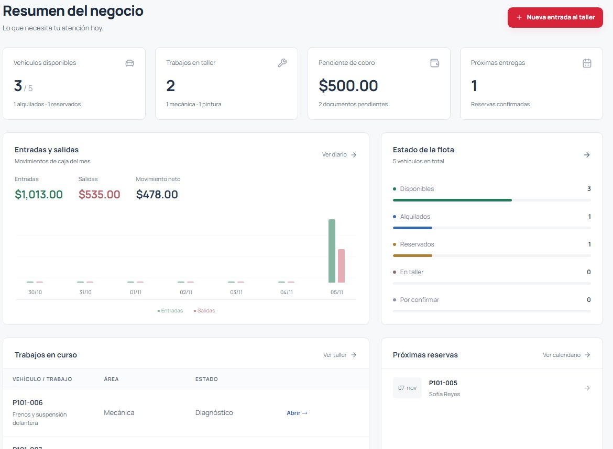
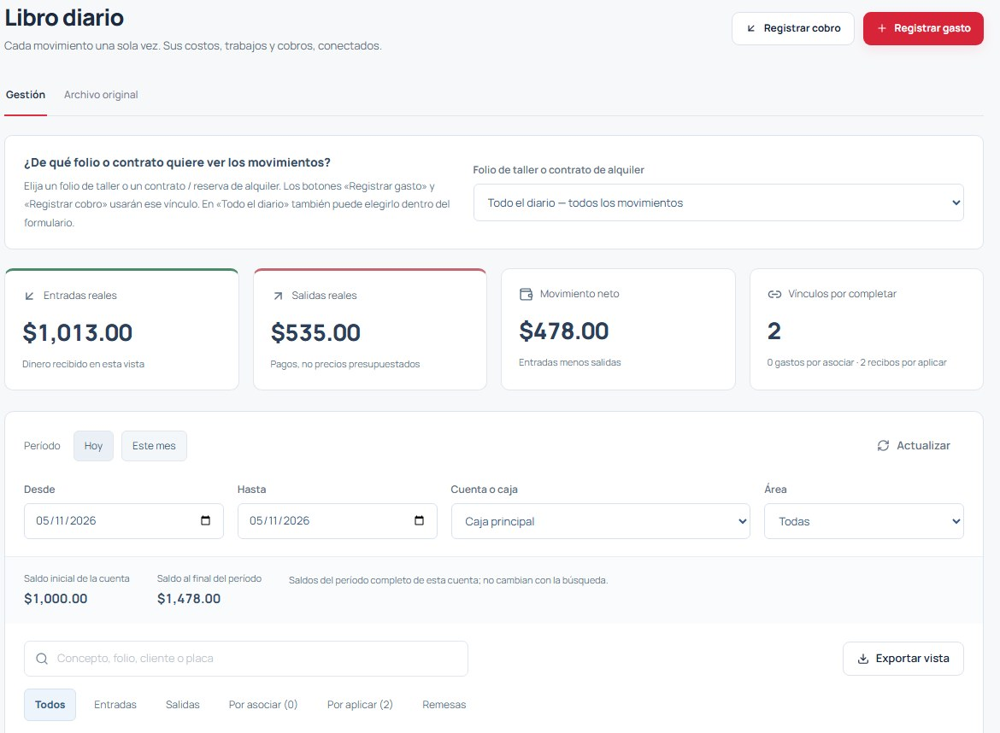
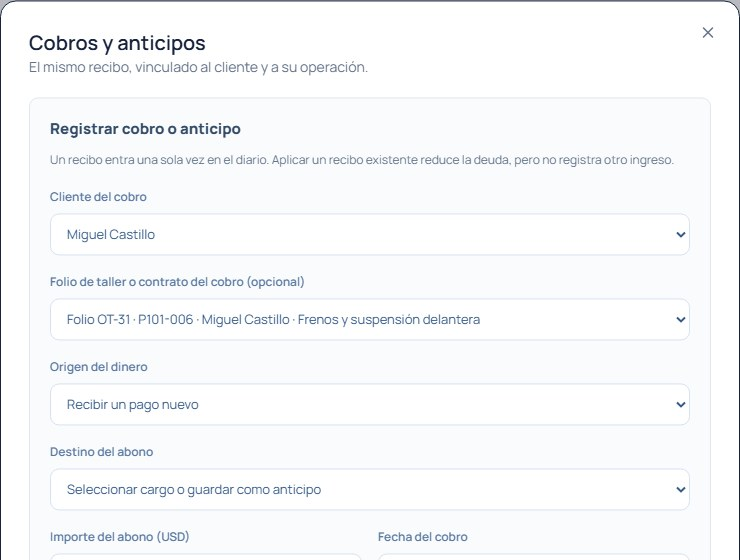
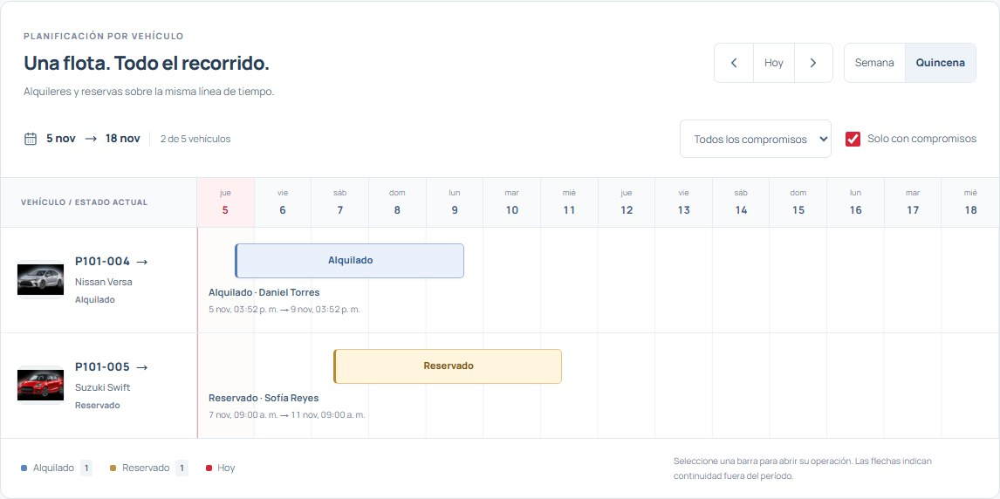

# AJ RENT A CAR
## Guía de presentación del avance
### Operación, trazabilidad y dinero conectado

**Fecha de referencia: 5 de noviembre de 2026 · Importes en USD · Horario de El Salvador**

Esta guía permite presentar el sistema por partes, recorrer los casos que ya existen y realizar operaciones nuevas con resultados comprobables. No se ejecutaron los ejercicios de este documento: la aplicación y los registros operativos se dejaron como estaban.

**Acceso:** [Abrir AJ Rent a Car](http://127.0.0.1:3030/inicio/). Ingresar con la cuenta habitual.

### La idea central de la presentación
> Un cliente y su vehículo tienen operaciones identificadas. Cada operación conserva su presupuesto, cargos, recibos, gastos y estado físico. Las pantallas muestran distintas partes de esa misma historia, sin volver a registrar el mismo dinero.

### Cómo utilizar este documento
- **Primero:** comprender las diferencias entre folio, cargo, recibo, aplicación y gasto.
- **Después:** mostrar los casos existentes sin guardar cambios.
- **Finalmente:** ejecutar las secuencias A y B, si se desea mostrar cambios en vivo.
- Los importes iniciales dejan de ser la referencia una vez que se guardan operaciones nuevas. Las tablas de control muestran cómo deben evolucionar.

**Casos existentes:** secciones 01 a 12. **Operaciones en vivo:** A y B en las secciones 13 a 19; alternativas C y D en 20 y 21. **Cierre y apoyo:** secciones 22 a 24.

<!-- page -->
# 01 · Antes de presentar: cinco conceptos

No comenzar por llenar formularios. Comenzar por explicar qué representa cada registro.

| Concepto | Qué significa | Qué NO significa |
| --- | --- | --- |
| Folio de taller / alquiler | Identifica el trabajo o la operación que se está atendiendo. | No es, por sí mismo, una deuda ni un pago. |
| Presupuesto | Alcance y precio propuestos; puede tener versiones y aprobación. | Guardarlo o aprobarlo no equivale a cobrar. |
| Cargo | Importe que se documenta como cuenta por cobrar. | Emitirlo no significa que el dinero haya entrado. |
| Recibo | Dinero recibido de un cliente. | No necesariamente quedó aplicado a una deuda. |
| Aplicación | Asigna un recibo ya recibido a un cargo. | No es una segunda entrada de dinero. |
| Gasto pagado | Dinero que sale y puede asociarse a una operación. | No aumenta automáticamente lo que debe el cliente. |

### El ejemplo más fácil: el Sentra
Miguel Castillo tiene el Sentra **P101-006**, atendido en **OT-31 / OT-00031**. Hay un cargo por **$600**, un recibo aplicado por **$200** y quedan **$400 por cobrar**.

- **En Cargos y cobros:** cargo $600, abonos aplicados $200, saldo $400.
- **En Libro diario:** entrada real de $200. El cargo de $600 no se presenta como entrada de caja.
- También hay una salida real de $180 por materiales. El movimiento de caja relacionado es $200 − $180 = **$20**; esto **no es una utilidad final**.

> En esta versión, «Libro diario» es un registro de movimientos de caja y sus vínculos. No es todavía un libro contable de partida doble con asientos de Debe/Haber y plan de cuentas.

<!-- page -->
# 02 · Folios: qué número se elige

Los prefijos distinguen documentos que no deben confundirse.

| Prefijo | Identifica | Ejemplo existente |
| --- | --- | --- |
| OT | Trabajo o folio de taller | OT-31, presentado también como OT-00031: Sentra. |
| ALQ | Operación de alquiler | ALQ-00006: Versa activo; ALQ-00007: Swift reservado. |
| PRE | Documento de presupuesto / versión | PRE-00013: versión 2 aprobada del trabajo OT-31. |
| CAR | Cargo o cuenta por cobrar | CAR-00009: $600 del Sentra; saldo actual $400. |
| REC | Recibo de dinero del cliente | REC-00010: $200 recibidos de Miguel. |
| EG | Comprobante de egreso | Un gasto original, aunque se distribuya entre varios trabajos. |

### El orden del registro de cobro
**Cliente → folio OT o alquiler ALQ → cargo CAR → recibo nuevo o existente → importe.**

1. El **cliente** limita las operaciones y los recibos que se pueden seleccionar.
2. El **folio** indica a qué trabajo o alquiler se vincula el movimiento.
3. El **cargo** indica qué deuda concreta se va a reducir.
4. El **origen del dinero** distingue recibir dinero nuevo de usar un recibo que ya entró antes.

### Dos particularidades de la pantalla actual
- Antes de elegir cliente, el selector del cobro puede indicar que no hay folios. Con **Miguel Castillo** sí aparece **Folio OT-31 · P101-006** y, como destino, **CAR-00009 · saldo $400**.
- Si el formulario se abrió desde un folio ya seleccionado, cliente y trabajo aparecen como contexto fijo. No se repite el selector, pero el vínculo existe.

**OT-31 y OT-00031 son el mismo trabajo.** El cero a la izquierda solo cambia su presentación. Las nuevas versiones PRE pueden tener un nuevo consecutivo; permanecen vinculadas a la misma OT.

<!-- page -->
# 03 · Orden recomendado de exposición

### Apertura sugerida
> «Hoy voy a mostrar un avance operativo conectado. No voy a recorrer pantallas aisladas: voy a seguir los mismos vehículos desde su operación hasta sus cargos, cobros y movimientos de caja».

| Tramo | Tiempo orientativo | Qué mostrar y qué afirmar |
| --- | --- | --- |
| 1. Resumen y conceptos | 3 minutos | Inicio; diferenciar disponibilidad, deuda y dinero. |
| 2. Flota y agenda | 4 minutos | Los cinco vehículos de flota; mensual y Gantt. |
| 3. Taller e historial | 4 minutos | Tres folios entregados; Sentra y Escape abiertos. |
| 4. Presupuestos y cobros | 5 minutos | Versiones del Sentra; cargo $600, abono $200 y saldo $400. |
| 5. Diario conectado | 4 minutos | Recibo original; gasto de $180 compartido entre tres folios. |
| 6. Caso vivo A | 10–15 minutos | Escape: revisión, aprobación, cargo, anticipo, cobro y gasto. |
| 7. Caso vivo B | 7–10 minutos | Nueva reserva del Corolla y, opcionalmente, su período y anticipo. |
| 8. Cierre | 2 minutos | Volver al resumen y explicar qué cambió y qué no. |

### Preparación inmediata
- Abrir la aplicación en **3030**, no el acceso anterior de 3040.
- Tener a mano estas placas: **P101-006 Sentra**, **P101-007 Escape**, **P101-004 Versa** y **P101-001 Corolla**.
- Para conciliar caja, usar **Libro diario → Hoy → Caja principal → Todo el diario**. Quitar búsquedas y filtros adicionales.
- Leer primero las secuencias. Guardar una operación la hace persistente; recargar no devuelve la carga inicial.
- No ejecutar importadores, limpiezas ni restauraciones para preparar la exposición.

**Si solo hay 15–20 minutos:** mostrar los casos existentes y realizar únicamente el caso vivo A hasta aplicar el anticipo. Es suficiente para demostrar la conexión sin apresurar todos los formularios.

<!-- page -->
# 04 · Inventario de los ejemplos existentes

| Vehículo | Placa | Cliente relacionado | Estado inicial y referencia |
| --- | --- | --- | --- |
| Toyota Corolla 2022 | P101-001 | Ana Martínez | Disponible. OT-00028 entregada; ALQ-00001 devuelto. |
| Hyundai Accent 2021 | P101-002 | Carlos Rivera | Disponible. OT-00029 entregada; ALQ-00002 devuelto. |
| Kia Rio 2023 | P101-003 | Lucía Hernández | Disponible. OT-00030 entregada; ALQ-00003 devuelto. |
| Nissan Versa 2022 | P101-004 | Daniel Torres | Alquilado. ALQ-00004 devuelto; ALQ-00006 activo. |
| Suzuki Swift 2023 | P101-005 | Sofía Reyes | Reservado. ALQ-00005 devuelto; ALQ-00007 preparado. |
| Nissan Sentra 2020 | P101-006 | Miguel Castillo | Taller, Mecánica. OT-00031 abierta. |
| Ford Escape 2021 | P101-007 | Valeria Flores | Taller, Pintura. OT-00032 abierta. |

### Qué representa el total
Hay **7 vehículos registrados**, pero solo **5 pertenecen a la flota de alquiler**. Los otros dos son vehículos de clientes en taller. Por eso la pantalla de flota no debe mostrar siete unidades alquilables.

La flota comienza con **3 disponibles, 1 alquilado y 1 reservado**. Taller comienza con **2 trabajos abiertos** y permite consultar **3 trabajos entregados**.

### Aclaración del historial
Los cinco alquileres devueltos se registraron con un período pactado de tres días y se terminaron por devolución anticipada. El precio pactado se conserva. Que una fecha final prevista sea posterior no convierte una devolución registrada en un alquiler activo.

**Frase de apoyo:** «El expediente del vehículo conserva lo anterior; abrir una nueva operación no borra su historia».

<!-- page -->
# 05 · Números iniciales que deben cuadrar

| Operación | Cargos emitidos | Abonos aplicados | Anticipo disponible | Saldo por cobrar | Gastos pagados |
| --- | --- | --- | --- | --- | --- |
| Cinco alquileres devueltos | $573 | $573 | $0 | $0 | $60 |
| Versa activo · ALQ-00006 | $180 | $80 | $0 | $100 | $25 |
| Swift reservado · ALQ-00007 | $0 | $0 | $60 | Sin cargo | $0 |
| Sentra · OT-00031 | $600 | $200 | $0 | $400 | $180 |
| Escape · OT-00032 | $0 | $0 | $100 | Sin cargo | $90 |
| Tres mantenimientos internos | $0 | $0 | $0 | No aplica | $180 |
| **Total** | **$1,353** | **$853** | **$160** | **$500** | **$535** |

### Tres comprobaciones independientes
- **Deuda:** $1,353 de cargos − $853 aplicados = **$500 pendientes**.
- **Dinero recibido:** $853 aplicados + $160 todavía disponibles = **$1,013 en recibos**. En esta carga no hay reembolsos que ajustar en esta igualdad.
- **Caja:** $1,000 de apertura + $1,013 de entradas − $535 de salidas = **$1,478 finales**. El movimiento neto comercial de caja es **$478**; la apertura no es una venta.

### No deducir una deuda que todavía no se emitió
El Swift tiene un precio previsto de **$152** y un anticipo de **$60**, pero aún no tiene cargo. No presentar automáticamente $92 como cartera emitida. El Escape tiene presupuesto de **$850** y anticipo de **$100**, pero tampoco tiene cargo; no presentar $750 como deuda actual.

**Formato:** se utiliza punto decimal y coma de miles, igual que en la aplicación: **$1,478.00**.

<!-- page -->
# 06 · Inicio y Clientes: comenzar por el contexto

### Inicio
**Ruta:** [Resumen del negocio](http://127.0.0.1:3030/inicio/).

1. Señalar **Vehículos disponibles: 3 / 5** y la separación entre alquilados y reservados.
2. Mostrar **Trabajos en taller: 2**: uno de Mecánica y uno de Pintura.
3. Mostrar **Pendiente de cobro: $500**, que corresponde a Sentra $400 y Versa $100.
4. Relacionar las entradas de $1,013 y salidas de $535 con el diario. No llamar «ganancia» al movimiento neto de $478.
5. Mostrar que las tarjetas permiten ir al área correspondiente.

### Clientes
**Ruta:** [Clientes](http://127.0.0.1:3030/clientes/).

1. Buscar **Miguel Castillo**, **Valeria Flores** o **Daniel Torres**.
2. Explicar que el cliente se reutiliza al seleccionar folios, cargos y recibos. No es necesario crear otra ficha para cobrarle un trabajo ya registrado.
3. Como ejemplo de alta, se puede abrir **Nuevo cliente** y mostrar los campos; usar **Cancelar** si solo se quiere explicar sin modificar el directorio.
4. Si se realiza un alta durante la exposición, anotar que el total de clientes dejará de ser siete. No repetirla para intentar «refrescar» la pantalla.

**Qué se demuestra:** el resumen se alimenta de operaciones y dinero guardados; el cliente es el punto de identidad común, no un registro distinto en cada módulo.

<!-- page -->
# 07 · Libro diario: leerlo sin confundirlo con cartera

**Ruta:** [Libro diario](http://127.0.0.1:3030/libro-diario/).

1. Elegir **Todo el diario — todos los movimientos**.
2. Pulsar **Hoy** y seleccionar **Caja principal** en **Cuenta o caja**.
3. Quitar la búsqueda. Comprobar entradas **$1,013**, salidas **$535**, neto **$478** y saldo final **$1,478**.
4. Cada ficha es un movimiento original. **REC** representa dinero recibido; **EG** representa una salida. Sus enlaces indican a qué operaciones se relaciona.
5. Abrir **Por aplicar**: hay dos recibos con dinero disponible, Escape $100 y Swift $60. Ya están dentro de las entradas: no son dinero pendiente de recibir.

### Qué hacen los filtros
- **Folio / contrato:** limita los comprobantes relacionados con esa operación.
- **Desde / Hasta y cuenta:** determinan el período y la cuenta que se consultan.
- **Búsqueda:** limita los movimientos visibles. Los indicadores de movimientos pueden cambiar con ella.
- **Saldo de cuenta:** es del período completo de esa cuenta; no se vuelve el «saldo del folio» por escribir una búsqueda.

**Importante:** al filtrar un folio, un comprobante compartido puede mostrarse completo. Su vínculo indica cuánto corresponde a ese trabajo. No sumar el comprobante completo nuevamente por cada folio.

<!-- page -->
# 08 · Registrar cobro: la secuencia exacta

### Desde Todo el diario
1. Pulsar **Registrar cobro**.
2. En **Cliente del cobro**, seleccionar **Miguel Castillo**. Antes de elegir cliente, no se ofrece el listado general de todos los folios.
3. En **Folio de taller o contrato del cobro (opcional)**, elegir **Folio OT-31 · P101-006 · Miguel Castillo**.
4. En **Origen del dinero**, distinguir **Recibir un pago nuevo** de **Usar REC-…**. La segunda opción reutiliza dinero ya recibido.
5. En **Destino del abono**, elegir **CAR-00009 · saldo $400.00**. Es la deuda a la que se aplicará el importe.
6. Completar importe, fecha, medio, **Caja principal** y referencia si se recibe un pago nuevo.
7. Revisar el botón: **Guardar cobro y aplicar al cargo** cobra y aplica; **Guardar anticipo vinculado** recibe dinero sin aplicarlo; **Aplicar recibo sin nuevo ingreso** no vuelve a cobrar.

### Desde una operación ya abierta
Elegir primero el folio del diario y después **Registrar cobro**, o usar **Cargos y cobros → Registrar abono** en su tarjeta. Cliente y operación quedan precargados. Que no haya un segundo selector de OT no significa que el cobro esté desvinculado.

**Para este recorrido sin cambios:** cerrar con **Cerrar**. No pulsar guardar hasta comenzar una secuencia en vivo.

<!-- page -->
# 09 · Caso existente: Sentra, de principio a fin

**Cliente:** Miguel Castillo · **Vehículo:** P101-006 · **Trabajo:** OT-00031 · **Área:** Mecánica.

### Recorrido de pantalla
1. En **Taller**, abrir el Sentra y señalar el motivo **Frenos y suspensión delantera**.
2. En **Recepción**, mostrar la inspección, kilometraje, condición y accesorios registrados.
3. En **Presupuestos**, abrir la última versión. El alcance inicial de **$520** se revisó a **$600** y esa revisión está aprobada. No sumar $520 + $600.
4. En **Costos**, localizar **$180** de materiales. Ya hay un gasto pagado; no registrar otro para «pasarlo» al presupuesto.
5. En **Cargos y abonos**, mostrar **CAR-00009 por $600**, **$200 aplicados** y **$400 de saldo**.
6. Seguir **Ver recibo en diario** para comprobar el movimiento original de **REC-00010 por $200**.
7. Volver a **Tareas**: el diagnóstico está finalizado y queda una tarea en proceso. No afirmar que el trabajo ya está entregado.

### Qué decir en cada enlace
> «Este presupuesto pertenece a esta OT. El cargo documenta lo que debe pagar el cliente. El recibo demuestra lo que entró a caja. La aplicación explica por qué la deuda bajó. El mismo trabajo se consulta desde distintas pantallas».

### Qué no mezclar
- Terminar una tarea no equivale a entregar el vehículo.
- Pagar el cargo no equivale a terminar la reparación.
- El costo conocido de $180 no permite asegurar la rentabilidad final: hay costos internos todavía no completos en el presupuesto.

**Prueba de trazabilidad:** poder ir de **OT → PRE → CAR → REC → Diario** y volver al mismo vehículo.

<!-- page -->
# 10 · Caso existente: Escape y anticipo sin cargo

**Cliente:** Valeria Flores · **Vehículo:** P101-007 · **Trabajo:** OT-00032 · **Área:** Pintura.

| Dato | Estado inicial |
| --- | --- |
| Presupuesto inicial | PRE-00014, versión 1: $700. |
| Última revisión | PRE-00015, versión 2: $850, en borrador. |
| Materiales ya pagados | $90. |
| Dinero recibido | REC-00011: $100. |
| Dinero aplicado a cargos | $0. |
| Cargo emitido | Ninguno. |

### Lo que debe observarse
1. Buscar P101-007 en **Presupuestos** y consultar las dos versiones.
2. Abrir **Cargos y cobros** para esa operación: mostrar el presupuesto, los costos y la indicación **Sin cargo**.
3. Señalar el anticipo vinculado de **$100**. El dinero está recibido aunque todavía no reduzca una deuda documentada.
4. Entrar a **Libro diario → Por aplicar** y localizar el recibo. No registrarlo de nuevo.

### Por qué el formulario no ofrece un CAR para este folio
Al elegir **Valeria Flores → OT-32**, el folio sí aparece. El selector de **Destino del abono** no tiene un cargo pendiente porque todavía no se emitió ninguno. Ofrecer **Anticipo** en esta situación es coherente; inventar un cargo para poder cobrar no lo sería.

**Frase de apoyo:** «Presupuesto, deuda y dinero se registran por decisiones distintas. Ahora voy a convertir este caso en una operación completa, paso por paso».

La secuencia A usa este caso. No ejecutarla antes de haber mostrado su estado inicial.

<!-- page -->
# 11 · Mantenimiento interno y un gasto compartido

### Tres trabajos cerrados que conservan su historia

| Folio | Vehículo | Servicio | Costo asignado |
| --- | --- | --- | --- |
| OT-00028 | Corolla P101-001 | Mantenimiento preventivo y cambio de aceite | $75 |
| OT-00029 | Accent P101-002 | Servicio de frenos y revisión de seguridad | $65 |
| OT-00030 | Rio P101-003 | Revisión eléctrica y batería | $40 |

1. En **Taller**, cambiar **Estado de los trabajos** a **Entregados**. Deben aparecer estos tres folios.
2. Abrir uno y revisar recepción, presupuesto de costo, tarea finalizada y acta de entrega.
3. Mostrar que su disposición es **Interno**. No hay una venta a AJ ni una deuda del negocio consigo mismo.
4. En **Libro diario**, buscar **Un comprobante de materiales**. Hay **una salida de $180**, con vínculos de **$75 + $65 + $40**.
5. Abrir los enlaces. Cada expediente conserva su porción del costo y remite al mismo comprobante original.

### El criterio que se presenta
**Repartir no es pagar de nuevo.** Tres asignaciones de costo no deben convertirse en tres egresos de $180.

### El historial de alquiler también permanece
En el expediente de cada uno de los cinco vehículos de flota, entrar a **Alquileres** y mostrar un alquiler **Devuelto**. Los importes de esos cinco alquileres son **$120, $108, $96, $135 y $114**: suman **$573**, ya cobrados y aplicados.

**Qué se demuestra:** un vehículo puede acumular trabajos y alquileres distintos sin perder su identidad, y un gasto puede sostener varias asignaciones sin multiplicar caja.

<!-- page -->
# 12 · Flota, Calendario y Gantt

### Vehículos
Mostrar los cuatro filtros: **Toda la flota**, **Disponibles**, **Alquilados** y **Reservados**. Los resultados iniciales son **5, 3, 1 y 1**. Abrir un expediente para mostrar historial, trabajos y documentos.

### Calendario y Gantt
1. Abrir **Calendario** y dejar noviembre de 2026.
2. Mostrar el mensual y luego el **Gantt debajo del mensual**.
3. Localizar **Versa P101-004**: ALQ-00006, entregado al cliente, final previsto el **9 de noviembre alrededor de las 15:52**.
4. Localizar **Swift P101-005**: ALQ-00007, confirmado y preparado, del **7 al 11 de noviembre, a las 09:00**.
5. Abrir una barra para comprobar cliente, placa y estado de la misma operación.
6. Desmarcar **Solo con compromisos** para incluir los vehículos sin ocupación mostrada. Navegar al mes siguiente y volver con **Hoy**.

### Qué significa cada decisión
- Guardar una **reserva borrador** no equivale a confirmarla.
- **Confirmar** comprueba disponibilidad y crea el compromiso operativo; no registra un cobro.
- **Entregar / devolver** requiere su operación e inspección. No basta con pagar.
- La devolución mantiene revisión de limpieza antes de liberar disponibilidad.

En celular el Gantt usa una ventana semanal. **Reservado** es una clasificación operativa derivada de una reserva vigente; para una fecha concreta se consulta el intervalo del calendario.

<!-- page -->
# 13 · Secuencia A: revisar y aprobar el Escape

**Punto de partida:** estado inicial del documento. **No se han ejecutado estos pasos al preparar la guía.**

### A1. Crear una revisión completa de $900
1. Ir a **Presupuestos**, buscar **P101-007** y abrir el presupuesto de **$850**.
2. Pulsar **Editar presupuesto**. Deben conservarse las dos partidas actuales.
3. Pulsar **Agregar mano de obra**.
4. Completar la tercera partida: descripción **Revisión final y acabado**, cantidad **1**, precio unitario **50**. Puede dejarse el costo interno sin completar; no convertirlo en un gasto pagado.
5. En **Observaciones / motivo del cambio**, escribir: **Se incorpora revisión final; se conserva el alcance completo del trabajo**.
6. Comprobar total **$900** y pulsar **Guardar presupuesto**. Anotar el nuevo PRE y su versión; no inventar manualmente el consecutivo.

**Resultado:** nueva versión en borrador vinculada a **OT-32**. Las anteriores de $700 y $850 permanecen. Todavía no hay cargo ni dinero nuevo.

### A2. Aprobar sin cobrar
1. Pulsar **Aprobar presupuesto**.
2. **Persona que aprueba:** Valeria Flores.
3. **Confirmación del cliente:** Autoriza alcance completo de reparación y acabado por $900.
4. Pulsar **Confirmar aprobación**.

**Resultado:** la revisión queda aprobada. La caja sigue en **$1,478** y la cartera global sigue en **$500**, porque aprobar no emite el cargo.

### A3. Clasificar el material que ya existía
En **OT-32 → Costos**, abrir **Clasificar costo** del material de **$90**. Elegir **Incluido**, seleccionar la nueva versión aprobada y escribir **Material comprendido en el alcance aprobado**. Pulsar **Guardar disposición**. No registrar otra compra ni otro egreso.

<!-- page -->
# 14 · Secuencia A: emitir el cargo y usar el anticipo

### A4. Documentar la deuda de $900
1. Abrir **Cargos y cobros** y buscar **P101-007**, o usar **Ver cargos y cobros** desde el presupuesto.
2. En la tarjeta del Escape, pulsar **Crear cargo del presupuesto**.
3. Mantener como fecha del cargo y vencimiento el **5 de noviembre de 2026** para esta presentación.
4. Verificar que el importe pendiente de emitir es **$900** y pulsar **Confirmar cargo**.

**Resultado:** Escape tiene un cargo de **$900**; la cartera global sube de **$500 a $1,400**. Los ingresos del diario siguen en **$1,013** y la caja en **$1,478**.

### A5. Aplicar los $100 ya recibidos
1. En esa misma tarjeta, pulsar **Registrar abono**.
2. En **Origen del dinero**, seleccionar **Usar REC-00011**, con **$100 disponibles**. No dejar «Recibir un pago nuevo».
3. En **Destino del abono**, elegir el nuevo **CAR del Escape**.
4. **Importe del abono (USD): 100**. Revisar la fecha de aplicación.
5. Pulsar **Aplicar recibo sin nuevo ingreso**.

| Control | Antes de aplicar | Después de aplicar |
| --- | --- | --- |
| Saldo del Escape | $900 | $800 |
| Saldo global por cobrar | $1,400 | $1,300 |
| Anticipos disponibles globales | $160 | $60 |
| Recibos acumulados | $1,013 | $1,013 |
| Caja final | $1,478 | $1,478 |

**Verificación cruzada:** ir a Libro diario y mostrar que el recibo original de $100 sigue siendo uno solo. Aplicar cambió el destino del dinero, no la cantidad recibida.

<!-- page -->
# 15 · Secuencia A: cobro nuevo y gasto nuevo

### A6. Recibir otros $25 para el Escape
En **Registrar abono**, completar:

| Campo | Valor |
| --- | --- |
| Origen del dinero | Recibir un pago nuevo |
| Destino del abono | El CAR del Escape con saldo $800 |
| Importe | 25 |
| Fecha del cobro | 5 de noviembre de 2026 |
| Medio de pago / cuenta | Efectivo / **Caja principal** |
| Referencia | Abono adicional de Valeria — acabado |

Pulsar **Guardar cobro y aplicar al cargo**. El Escape baja a **$775**; la cartera global queda en **$1,275**. Los recibos suben a **$1,038** y la caja a **$1,503**.

### A7. Pagar $15 de consumibles, sin aumentar la deuda
Desde la tarjeta del Escape, pulsar **Registrar gasto**. Concepto **Consumibles de acabado**; importe **15**; fecha **5 de noviembre**; vínculo **Folio de taller → OT-32**; categoría **Materiales**; medio **Efectivo**; cuenta **Caja principal**; soporte **ACABADO-01**. Pulsar **Guardar registro**.

**Resultado:** costo pagado del Escape **$105** ($90 + $15), gastos globales **$550**, caja final **$1,488**. El saldo del Escape sigue en **$775**: el gasto no es un cargo adicional al cliente.

En **OT-32 → Costos**, clasificar el nuevo costo como **Absorbido**, sin alcance comercial, con motivo **Consumible asumido por AJ, sin traslado al cliente**. Esto resuelve la decisión comercial sin volver a pagar ni modificar el cargo.

**Cierre del caso A:** volver al diario, localizar la nueva entrada de $25 y la salida de $15; después volver al folio y comprobar los mismos movimientos.

<!-- page -->
# 16 · Control acumulado de la secuencia A

Los valores de esta página suponen ejecutar **A1 a A7 una sola vez**, sin otras operaciones intermedias.

| Punto | Cargos globales | Recibos | Aplicados | Anticipos | Por cobrar | Gastos | Caja final |
| --- | --- | --- | --- | --- | --- | --- | --- |
| Inicial | $1,353 | $1,013 | $853 | $160 | $500 | $535 | $1,478 |
| Revisión $900 y aprobación | $1,353 | $1,013 | $853 | $160 | $500 | $535 | $1,478 |
| Emitir cargo $900 | $2,253 | $1,013 | $853 | $160 | $1,400 | $535 | $1,478 |
| Aplicar anticipo $100 | $2,253 | $1,013 | $953 | $60 | $1,300 | $535 | $1,478 |
| Cobro nuevo $25 | $2,253 | $1,038 | $978 | $60 | $1,275 | $535 | $1,503 |
| Gasto nuevo $15 | $2,253 | $1,038 | $978 | $60 | $1,275 | $550 | $1,488 |

### Tres preguntas para la audiencia
1. **¿Por qué aprobar $900 no aumentó la caja?** Porque es autorización comercial, no dinero recibido.
2. **¿Por qué aplicar $100 no generó otra entrada?** Porque ese recibo ya estaba dentro de los $1,013 iniciales.
3. **¿Por qué gastar $15 no subió la deuda del cliente?** Porque costo y precio se deciden por separado; en este ejercicio se absorbió el consumo.

### Lo que debe verse al finalizar
- Escape: presupuesto aprobado **$900**, cargo **$900**, aplicado **$125**, saldo **$775**, costos pagados **$105**.
- Sentra: conserva su saldo de **$400**. Versa: conserva su saldo de **$100**.
- Swift: conserva su anticipo disponible de **$60**, sin cargo.
- Caja global: **$1,000 + $1,038 − $550 = $1,488**.
- Recargar la pantalla conserva lo guardado. No volver a capturar el cobro o gasto si ya aparece confirmado.

**Momento para cerrar si hay poco tiempo:** esta secuencia ya mostró presupuesto → cargo → recibo → aplicación → diario → costo del expediente.

<!-- page -->
# 17 · Secuencia B: crear y confirmar una reserva

Puede realizarse después de A. Crear la reserva no cambia el dinero de A.

### B1. Nueva reserva del Corolla
Ir a **Calendario → Nueva reserva** y completar:

| Campo | Valor de la presentación |
| --- | --- |
| Cliente de reserva | Ana Martínez |
| Vehículo de reserva | P101-001 · Corolla |
| Alquiler sin fecha final definida | Desmarcado |
| Inicio de reserva | **13/11/2026, 09:00** |
| Fin de reserva | **15/11/2026, 09:00** |
| Tarifa diaria de reserva | **40** |
| Limpieza posterior | **60 minutos** |

1. Pulsar **Guardar borrador de reserva**. Se crea una operación nueva; anotar su ALQ. No confundirla con el alquiler histórico **ALQ-00001** de la misma Ana y el mismo Corolla.
2. En el detalle, comprobar fechas y precio previsto de **$80** por dos días.
3. Pulsar **Confirmar reserva**. Esta es la decisión que comprueba disponibilidad y compromete el intervalo.
4. Cerrar el detalle y ubicar el Corolla en el mensual y el Gantt de noviembre. En vista semanal, navegar a la semana que contiene el día 13.
5. Abrir la barra y comprobar que apunta a la nueva operación.

**Resultado operativo:** con la carga inicial sin otros cambios, la clasificación de flota pasa a **2 disponibles, 1 alquilado y 2 reservados**. El Gantt incorpora el nuevo compromiso.

**Resultado financiero:** no hay cargo, cobro ni gasto automático. Después de A, la cartera sigue en **$1,275** y la caja en **$1,488**.

<!-- page -->
# 18 · Secuencia B: anticipo y período documentado

Estos pasos son opcionales. Siguen a **A completa y B1**; no deben mezclarse con el ALQ histórico del Corolla.

### B2. Recibir un anticipo de $20
En **Cargos y cobros**, localizar la nueva reserva por placa, cliente y fechas. Pulsar **Registrar anticipo**. Elegir **Recibir un pago nuevo → Anticipo — todavía sin aplicar a un cargo**. Importe **20**, fecha **5 de noviembre**, medio **Efectivo**, cuenta **Caja principal**, referencia **Anticipo Corolla 13–15 noviembre**. Pulsar **Guardar anticipo vinculado**.

**Resultado:** entra $20, pero aún no se crea una deuda. Recibos globales **$1,058**, anticipos disponibles **$80**, caja **$1,508** y cartera todavía **$1,275**.

### B3. Documentar el período de $80
Abrir el **nuevo pliego de alquiler → Períodos y abonos → Documentar otro período de alquiler**.

| Campo | Valor |
| --- | --- |
| Período desde (inclusive) | 13/11/2026 |
| Período hasta (inclusive) | **14/11/2026** |
| Importe acordado del período | 80 |
| Fecha de emisión | 05/11/2026 |
| Vencimiento | 13/11/2026 |
| Acuerdo del período | Dos días de Corolla a $40; devolución el 15 a las 09:00. |

Pulsar **Emitir cargo del período (no registra cobro)**. El período usa fechas inclusivas: 13 y 14 son dos días; no introducir 15 como tercer día. La reserva termina el 15 a las 09:00.

**Resultado:** cargos globales **$2,333**, cartera **$1,355**, caja todavía **$1,508**.

### B4. Aplicar los $20 ya recibidos
En el formulario del mismo alquiler, elegir el recibo disponible de **$20** como origen, el nuevo CAR de **$80** como destino e importe **20**. Pulsar **Aplicar recibo sin nuevo ingreso**. Quedan **$60** por cobrar en esta nueva reserva; no entra dinero adicional.

<!-- page -->
# 19 · Control acumulado después de A y B

Esta tabla solo corresponde a **A1–A7 y B1–B4**, en ese orden y sin movimientos adicionales.

| Punto | Cargos | Recibos | Aplicados | Anticipos | Por cobrar | Gastos | Caja final |
| --- | --- | --- | --- | --- | --- | --- | --- |
| Fin de A | $2,253 | $1,038 | $978 | $60 | $1,275 | $550 | $1,488 |
| Confirmar nueva reserva | $2,253 | $1,038 | $978 | $60 | $1,275 | $550 | $1,488 |
| Recibir anticipo $20 | $2,253 | $1,058 | $978 | $80 | $1,275 | $550 | $1,508 |
| Emitir período $80 | $2,333 | $1,058 | $978 | $80 | $1,355 | $550 | $1,508 |
| Aplicar esos $20 | $2,333 | $1,058 | $998 | $60 | $1,335 | $550 | $1,508 |

### Conciliación final de la cartera

| Operación | Saldo al terminar A y B |
| --- | --- |
| Escape · OT-00032 | $775 |
| Sentra · OT-00031 | $400 |
| Versa activo · ALQ-00006 | $100 |
| Nueva reserva del Corolla | $60 |
| **Total por cobrar** | **$1,335** |

El anticipo restante de **$60** corresponde al Swift. La caja es **$1,000 + $1,058 − $550 = $1,508**. Los $1,335 de cartera no deben sumarse a esa caja como si ya se hubieran cobrado.

### Frase de cierre del caso B
> «La reserva cambió la agenda. El cargo cambió la deuda. El anticipo cambió caja y dinero disponible. Su aplicación solo cambió la asignación. Son decisiones conectadas, pero no son el mismo hecho».

<!-- page -->
# 20 · Secuencia alternativa: terminar el Sentra

Ejercicio opcional para mostrar que **saldo, tarea y entrega son estados separados**. No es necesario hacerlo si la presentación ya cerró con A y B.

### C1. Cobrar el saldo de $400
Abrir **Cargos y cobros → Sentra → Registrar abono**. Cliente y OT vienen precargados. Elegir **Recibir un pago nuevo**, **CAR-00009**, importe **400**, fecha del cobro, **Efectivo**, **Caja principal** y referencia **Liquidación Sentra**. Pulsar **Guardar cobro y aplicar al cargo**.

**Resultado local:** el Sentra queda con cargo $600, aplicado $600 y saldo $0. No cambia automáticamente la tarea ni se entrega el vehículo.

| Referencia de ejecución | Cartera global después del cobro | Caja final |
| --- | --- | --- |
| C desde la carga inicial | $100 | $1,878 |
| C después de A y B completos | $935 | $1,908 |

### C2. Finalizar el trabajo pendiente
Abrir **OT-31 → Tareas** y localizar **Instalar kit de frenos y comprobar suspensión**, actualmente en proceso. Pulsar **Finalizar tarea**. Mostrar que no modifica los recibos ni cierra por sí sola el folio.

### C3. Revisar y confirmar la entrega
En **Salida**, pulsar **Actualizar revisión**. Revisar costos sin disposición, tareas, cronómetros, decisión de presupuesto y recepción. Deben resolverse los pendientes antes de continuar. No utilizar una excepción para ocultarlos.

Si la revisión permite la entrega ordinaria: persona que recibe **Miguel Castillo**; evidencia **Se verificaron frenos y suspensión; recepción conforme del vehículo**. Pulsar **Confirmar entrega revisada**.

**Resultado esperado:** OT-31 pasa a entregada y conserva su acta e historial. El Sentra es un vehículo de cliente: entregarlo no lo incorpora a la flota de alquiler. Si un control rechaza la entrega, mostrar el motivo y resolverlo; no forzar el estado.

<!-- page -->
# 21 · Secuencia alternativa: devolver el Versa

Ejercicio opcional sobre **ALQ-00006**, el alquiler activo de Daniel Torres. Su devolución no debe confundirse con el histórico ALQ-00004.

### D1. Registrar devolución con inspección
Abrir el pliego activo del Versa → **Salida y devolución**.

| Campo | Valor orientativo para mantener la comparación del ejemplo |
| --- | --- |
| Kilometraje de inspección | 36360, mayor o igual que el registrado en la salida. |
| Combustible | 80% |
| Condición | Sin daños adicionales; carrocería y luces revisadas. |
| Accesorios | Llave, repuesto, herramientas y documentos |
| Evidencia | Se revisó el retorno y se deja pendiente la limpieza de devolución. |

Revisar el estado actual y pulsar **Registrar devolución de alquiler** solo si se quiere completar realmente ese paso de la presentación. No registrar una salida nueva.

### D2. Mostrar qué NO cambió
- La operación queda devuelta, pero **los $100 pendientes del cargo no desaparecen** por devolver físicamente el vehículo.
- No se ajusta automáticamente el precio pactado de $180 por una devolución anticipada.
- La disponibilidad no debe liberarse sin revisar el bloqueo de limpieza.
- Diferencias de combustible o condición pueden generar propuestas de extras; no equivalen a un cargo automático aprobado.

### D3. Revisar y finalizar limpieza
Ir a **Calendario → Bloqueos**, ubicar la limpieza del **Versa y este alquiler**, abrir **Revisar bloqueo**, indicar el motivo y usar **Finalizar bloqueo y revisar disponibilidad**. No finalizar un bloqueo de otro vehículo o trabajo.

Al liberarlo, revisar flota y Gantt. Sin la nueva reserva B, la flota queda **4 disponibles y 1 reservado**; si B está confirmada, queda **3 disponibles y 2 reservados**, sin alquilados. La caja no cambia por estas decisiones físicas.

<!-- page -->
# 22 · Controles y preguntas durante la exposición

| Si preguntan… | Qué mostrar o responder |
| --- | --- |
| «¿Por qué no aparecen los folios en Registrar cobro?» | Elegir primero el cliente. Miguel carga OT-31; desde la OT el vínculo ya está precargado. |
| «El folio aparece, pero no el cargo» | Verificar si hay un CAR con saldo. Escape inicialmente no tiene cargo; un presupuesto no basta. |
| «¿Puedo pagarle otro trabajo con el mismo anticipo?» | Solo dentro de los controles de cliente, disponibilidad del recibo y alcance admitido. Elegir el destino correcto; no duplicar el recibo. |
| «¿Una reserva confirmada ya está pagada?» | No. Confirmación operativa, cargo emitido y dinero aplicado son estados separados. |
| «¿Qué pasa si se cruza una reserva?» | La confirmación debe comprobar los compromisos. No prometer disponibilidad por el solo hecho de guardar un borrador. |
| «¿Por qué el diario no cambia al aprobar?» | Porque aprobar el alcance no mueve caja. Mostrar después la emisión y el cobro como acciones distintas. |
| «¿El gasto se suma a la deuda del cliente?» | No automáticamente. Requiere una decisión comercial y, cuando corresponda, un alcance y cargo autorizados. |
| «¿El neto es la utilidad?» | No. Es movimiento de caja; costos incompletos, anticipos y cartera impiden tratarlo como utilidad final. |

### Si algo no aparece
1. Confirmar que se está en **3030**, con la cuenta habitual.
2. Revisar cliente, placa, folio, intervalo de fechas, cuenta y filtros. Un cliente puede tener más de un alquiler del mismo vehículo.
3. Esperar que termine **Consultando cargos y recibos…**. Durante la consulta no concluir que faltan documentos.
4. Usar **Actualizar** o recargar después de una confirmación. Si el registro ya existe, no guardarlo de nuevo.
5. Si un guardado devuelve un error, leerlo y revisar el estado real antes de repetir. No borrar historiales ni restaurar toda la carga como respuesta a un filtro incorrecto.

<!-- page -->
# 23 · Qué se puede afirmar y cuáles son los límites

### Avance comprobado en la carga actual
- Ocho módulos operativos: Inicio, Clientes, Vehículos, Calendario, Taller, Presupuestos, Cargos y cobros y Libro diario.
- Siete expedientes de vehículos; cinco folios de taller; cinco alquileres devueltos y dos operaciones actuales de flota.
- Presupuestos versionados, aprobación, cargos, recibos y gastos conectados sin convertir cada vínculo en otro movimiento de caja.
- Aceptación de las ocho pantallas en anchos **320, 390, 768 y 1440 px**, sin desplazamiento horizontal en el recorrido validado.
- Descargas comprobadas de presupuesto PDF, contrato PDF, CSV e imagen privada.
- Conservación verificada de usuarios, configuración, auditoría anterior y los cuatro Excel originales. No se expusieron credenciales en el documento.

### Límites que deben expresarse con precisión
- El registro de caja **no sustituye** una contabilidad completa de partida doble ni una emisión fiscal.
- Guardar una evidencia de WhatsApp conserva texto; **no envía un mensaje** por WhatsApp.
- El contrato conserva versión y aceptación registrada; **no afirmar que incluye firma electrónica certificada** ni una validación legal no implementada.
- Una imagen de referencia no es una inspección física certificada. La condición se verifica mediante su registro y sus soportes.
- No anunciar margen o utilidad definitiva si faltan costos internos. No confundir un anticipo disponible con una deuda cobrada.

### Documentos y originales
Mostrar **Archivo original** desde los módulos que lo incluyen. Son referencias y descargas conservadas, no instrucciones para volver a importar todos los registros anteriores. Las 54 asociaciones al conjunto reemplazado se retiraron para no dejar vínculos activos a entidades inexistentes.

**Cierre sugerido:** «El avance conecta la operación y el dinero con trazabilidad. Lo importante no es que todos los valores cambien siempre, sino que cada acción cambie únicamente lo que le corresponde».

<!-- page -->
# 24 · Hoja de apoyo del presentador

### Accesos directos

| Abrir | Enlace |
| --- | --- |
| Inicio | [Resumen del negocio](http://127.0.0.1:3030/inicio/) |
| Taller del Sentra | [OT-31 · P101-006](http://127.0.0.1:3030/taller/ingreso/?id=OT-31) |
| Taller del Escape | [OT-32 · P101-007](http://127.0.0.1:3030/taller/ingreso/?id=OT-32) |
| Cobros del Sentra | [Cartera OT-31](http://127.0.0.1:3030/cobros/?operacion=OT-31) |
| Cobros del Escape | [Cartera OT-32](http://127.0.0.1:3030/cobros/?operacion=OT-32) |
| Diario del Sentra | [Movimientos OT-31](http://127.0.0.1:3030/libro-diario/?operacion=OT-31) |
| Diario del Escape | [Movimientos OT-32](http://127.0.0.1:3030/libro-diario/?operacion=OT-32) |
| Versa activo | [ALQ-00006](http://127.0.0.1:3030/vehiculos/alquiler/?id=65e5b852-47f4-4221-82cb-ff8bc730b02e) |
| Swift reservado | [ALQ-00007](http://127.0.0.1:3030/vehiculos/alquiler/?id=b0cdfb43-8a4d-406b-bc23-bcd43488f54d) |

### Verificación de cierre
- [ ] Pude mostrar el mismo folio desde Taller, Presupuesto, Cobros y Diario.
- [ ] Distinguí presupuesto, cargo, recibo, aplicación y gasto.
- [ ] Si ejecuté A: Escape quedó con saldo $775 y caja global $1,488.
- [ ] Si ejecuté A y B completos: cartera $1,335 y caja global $1,508.
- [ ] Si ejecuté C o D, expliqué sus efectos adicionales y no seguí comparando con la carga inicial.
- [ ] Los ejercicios opcionales no ejecutados se presentaron como próximos pasos, no como resultados ya guardados.

### Anotar durante la práctica
Nuevo PRE del Escape: __________ · Nuevo CAR del Escape: __________

Nuevo ALQ del Corolla: __________ · Su CAR: __________ · Su REC: __________

Saldo de cartera observado al cerrar: __________ · Caja final observada: __________

**Fuente del documento:** lectura de los registros actuales y revisión de formularios del sistema; comprobación de folios del cobro en navegador sin guardar movimientos. Las secuencias nuevas describen lo que el presentador puede hacer, no cambios ya aplicados por la guía.
