# AJ RENT A CAR
## Recorrido pantalla por pantalla
### Guion para presentar la aplicación mientras se utiliza

**Abrir:** [http://127.0.0.1:3030/inicio/](http://127.0.0.1:3030/inicio/). Ingresar con la cuenta habitual y seguir el menú de arriba hacia abajo.

| Orden | Pantalla del menú | Ejemplo que se muestra |
| --- | --- | --- |
| 01 | Inicio | Resumen de flota, taller, cobros y caja. |
| 02 | Clientes | Miguel Castillo y su trabajo del Sentra. |
| 03 | Vehículos | Versa: alquiler actual, cobro, devolución y limpieza. |
| 04 | Calendario | Mensual, Gantt y formulario de nueva reserva. |
| 05 | Taller | Sentra, Escape, tareas e ingresos entregados. |
| 06 | Presupuestos | Versiones del Sentra y edición del Escape. |
| 07 | Cargos y cobros | Saldo del Sentra y formulario de abono. |
| 08 | Libro diario | Recibo, gasto, vínculo al folio y saldo de caja. |

**En cada página:** qué botón tocar, qué debe aparecer, qué decir y cómo continuar. Las páginas con números decimales son detalles que se abren desde la pantalla principal anterior.

### Dos formas de seguir el mismo recorrido
- **Solo mostrar:** abrir las fichas y formularios, pero cerrar con **Cerrar** o **Cancelar**. Se conserva la carga.
- **Hacer ejemplos en vivo:** guardar únicamente los pasos identificados como **Ejemplo para guardar**. Se indica qué debe cambiar después. No se ejecutaron esos guardados para crear este documento.

**Referencia:** consulta del 5 de noviembre de 2026, con los registros nuevos conservados. Cartera **$500** y caja final **$1,478**. Si se registran otros movimientos, usar el saldo que muestre la aplicación, no forzar estos importes.

<!-- page -->
# 01 · Inicio

**Dónde entrar:** menú izquierdo → **Inicio**. Debe aparecer **Resumen del negocio**.

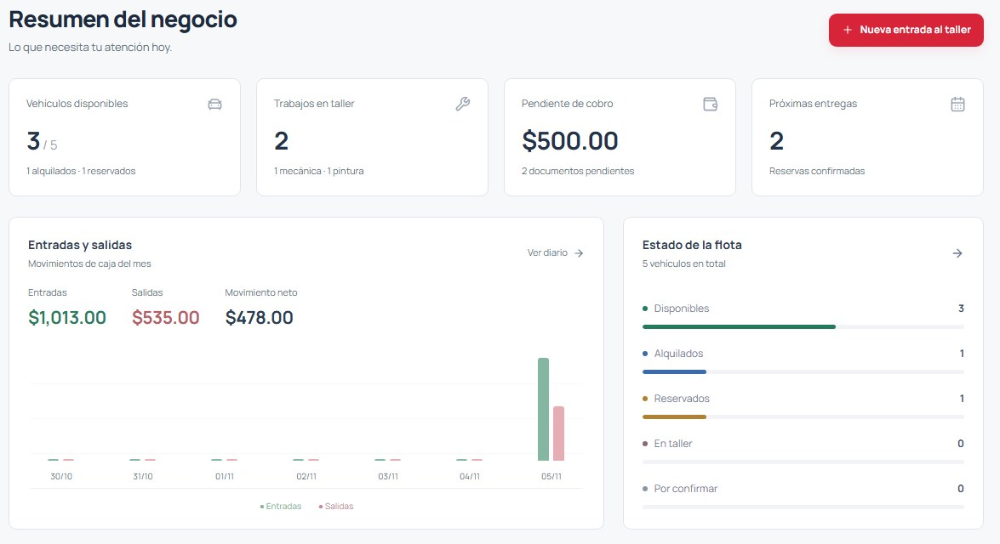

### Qué hacer, en este orden
1. Señalar la tarjeta **Vehículos disponibles**: **3 / 5**. Debajo aparecen **1 alquilado y 1 reservado**.
2. Señalar **Trabajos en taller**: **2**, separados en Mecánica y Pintura.
3. Señalar **Pendiente de cobro**: **$500**, correspondientes a Sentra $400 y Versa $100.
4. Bajar a **Entradas y salidas**: entradas **$1,013**, salidas **$535** y neto **$478**.
5. Bajar a **Trabajos en curso** y **Próximas reservas**. Señalar el Sentra, el Escape y la próxima reserva del Swift.

### Qué decir
> «Esta es la pantalla de entrada. Resume lo que ya está registrado en las otras áreas: vehículos, trabajos abiertos, reservas y dinero. Ahora voy a recorrer esas áreas en el mismo orden del menú».

**No confundir:** los cinco son vehículos de flota; además existen dos vehículos de clientes en taller. El neto de caja no se presenta como utilidad final.

**Para seguir:** pulsar **Clientes** en el menú izquierdo. No comenzar todavía un ingreso de taller desde el botón superior.

<!-- page -->
# 02 · Clientes

**Dónde entrar:** menú izquierdo → **Clientes**.

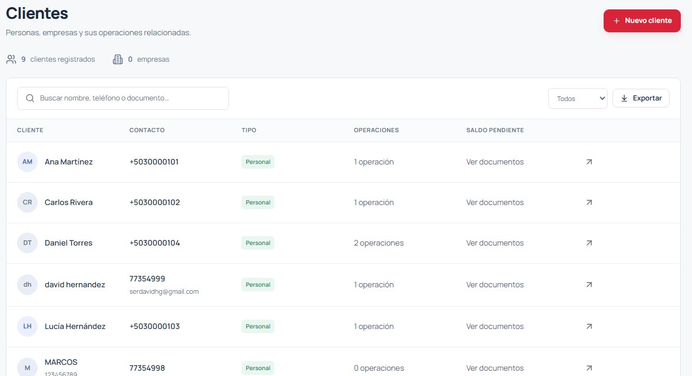

### Qué hacer
1. Señalar el **total actual de clientes**, incluidos los nuevos registros.
2. En el buscador **Buscar nombre, teléfono o documento…**, escribir **Miguel**.
3. Identificar la fila **Miguel Castillo**. Mostrar contacto, tipo y cantidad de operaciones.
4. En **Saldo pendiente**, señalar **Ver documentos**: la deuda documentada se consulta en Cargos y cobros, no se captura otra vez en esta fila.
5. En el extremo derecho de la fila, pulsar el botón con flecha **Ver cliente Miguel Castillo**.

### Qué decir
> «Aquí se administra la identidad del cliente. Voy a abrir a Miguel para comprobar que su ficha está relacionada con el trabajo del Sentra; no estoy creando otro cliente para cada operación».

### Si se quiere mostrar un alta
Pulsar **Nuevo cliente**: nombre **Paola Mendoza**, teléfono **0000-0201**, tipo **Personal**. Correo y documento pueden quedar vacíos.

- **Solo mostrar:** pulsar **Cancelar**.
- **Ejemplo para guardar:** pulsar **Guardar registro** una vez. Suma un cliente, no vehículo, reserva ni cobro. Si la ficha ya existe, no repetir el alta.

**Para seguir:** abrir la ficha de Miguel (página siguiente); cerrar y elegir **Vehículos**.

<!-- page -->
# 02.1 · Clientes → Ficha de Miguel

**Cómo se llega:** Clientes → buscar **Miguel** → botón con flecha de su fila.

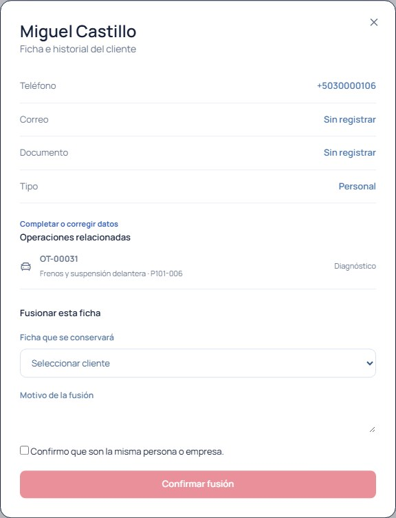

### Qué hacer dentro de la ficha
1. Mostrar el nombre **Miguel Castillo** y los datos de contacto disponibles.
2. Ubicar **Operaciones relacionadas**.
3. Señalar **OT-00031**, el trabajo **Frenos y suspensión delantera** y la placa **P101-006**.
4. Explicar que ese será el mismo trabajo que se abrirá desde Taller, Presupuestos y Cargos y cobros.
5. No utilizar **Fusionar esta ficha** durante este recorrido: no hay que combinar clientes para presentar el ejemplo.
6. Cerrar con la **X / Cerrar** del cuadro.

### Qué decir
> «Esta ficha no termina en los datos personales. Tiene la operación del cliente. La referencia que vamos a seguir es OT-31, del Sentra P101-006».

**Tiene que verse:** Miguel y su OT. La ficha del cliente no debe abrir un trabajo nuevo ni generar un movimiento de dinero al consultarla.

**Para seguir:** pulsar **Vehículos** en el menú izquierdo.

<!-- page -->
# 03 · Vehículos

**Dónde entrar:** menú izquierdo → **Vehículos**.

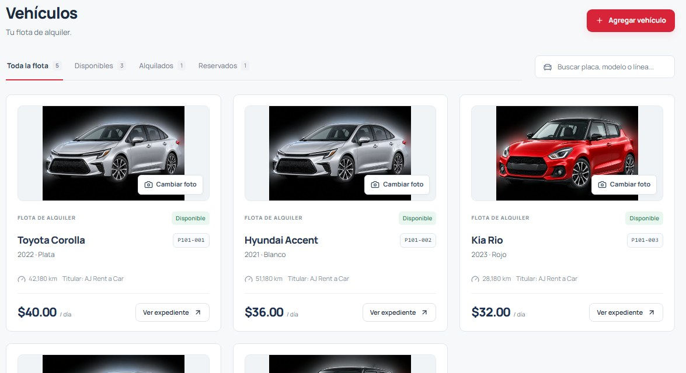

### Qué hacer
1. Pulsar **Toda la flota**: deben verse **5 vehículos** de alquiler.
2. Pulsar **Disponibles**: Corolla, Accent y Rio; total **3**.
3. Pulsar **Alquilados**: Versa **P101-004**; total **1**.
4. Pulsar **Reservados**: Swift **P101-005**; total **1**.
5. En **Buscar vehículo**, escribir **P101-004** para ubicar el Versa.
6. En su tarjeta, pulsar **Ver expediente**. La primera tarjeta del expediente será el alquiler actual, no los totales históricos.

### Qué decir
> «Esta pantalla es la flota de alquiler. Cada tarjeta muestra la unidad y su estado. El historial no está dentro de una reserva suelta: se abre desde el expediente permanente del vehículo».

**Si preguntan por Sentra y Escape:** no faltan registros. Son vehículos de clientes en taller, no unidades de alquiler. Se muestran en Taller.

**Para seguir:** abrir el expediente del Versa y continuar con su alquiler, cobro y devolución.

<!-- page -->
# 03.1 · Vehículos → Alquiler actual del Versa

**Cómo se llega:** Vehículos → Nissan Versa **P101-004** → **Ver expediente**.

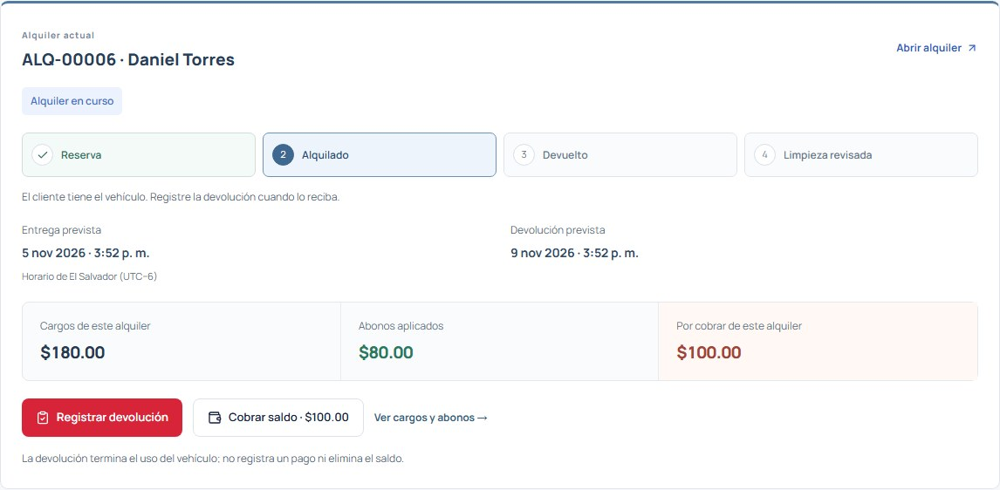

### Qué señalar, de arriba hacia abajo
1. La tarjeta **Alquiler actual**: **ALQ-00006 · Daniel Torres**.
2. El recorrido visual **Reserva → Alquilado → Devuelto → Limpieza revisada**. La etapa actual es **Alquilado**.
3. **Entrega prevista:** 5 nov 2026, 3:52 p. m. **Devolución prevista:** 9 nov 2026, 3:52 p. m. Ambas en horario de El Salvador.
4. Los importes de esta operación: **cargos $180**, **abonos $80**, **por cobrar $100**.
5. Más abajo, **Reservas por entregar**: **ALQ-00008 · david hernandez**, del **15 nov, 7:33 p. m.**, al **18 nov, 7:33 p. m.** Es otra operación, todavía sin entregar.
6. Desplegar **Historial de alquileres** para abrir ALQ-00004. Los totales históricos del vehículo están separados y plegados.

### Qué decir
> «El cliente tiene el carro en este alquiler. Aquí puedo cobrar sus $100 o registrar su devolución. La reserva de David es posterior; no reemplaza este alquiler ni se entrega automáticamente».

**Para seguir:** en la tarjeta del alquiler actual, pulsar **Cobrar saldo · $100.00**.

<!-- page -->
# 03.2 · Versa → Cobrar los $100 pendientes

**Cómo se llega:** expediente del Versa → **Alquiler actual** → **Cobrar saldo · $100.00**.

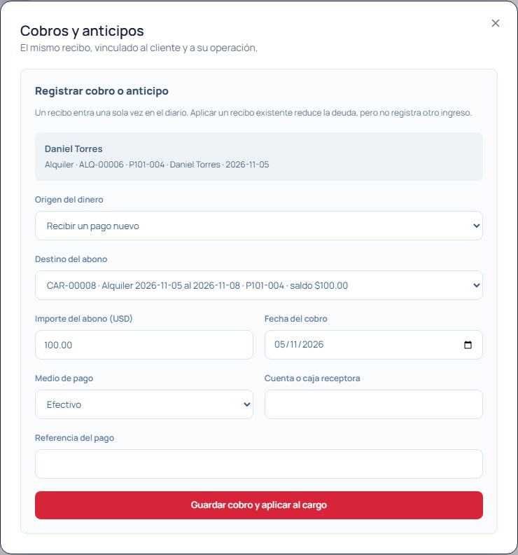

### Qué comprobar en el cuadro
1. Arriba deben aparecer **Daniel Torres**, **ALQ-00006** y **P101-004**.
2. **Origen del dinero:** **Recibir un pago nuevo**. Si el cliente ya dejó un recibo disponible, elegirlo aquí en vez de recibir el dinero otra vez.
3. **Destino del abono:** el cargo pendiente de este alquiler ya viene seleccionado cuando es el único.
4. **Importe del abono:** **100.00**. Puede cambiarse para un pago parcial, sin superar el saldo.
5. Para un cobro real, completar fecha, medio de pago, **Caja principal** y una referencia comprobable.

### Cómo continuar sin alterar el recorrido
Pulsar **X / Cerrar**. No guardar este cobro durante la consulta: las páginas posteriores mantienen el ejemplo del Versa con $100 pendientes.

**Si se decide guardar un pago real:** pulsar **Guardar cobro y aplicar al cargo** una sola vez. Si se cobran los $100, el saldo de ALQ-00006 queda en cero y entra un recibo de $100 al Libro diario. La cartera global baja $100; no finaliza el uso del vehículo.

**Para seguir:** cerrar el cuadro y pulsar **Registrar devolución** en la tarjeta del alquiler actual.

<!-- page -->
# 03.3 · Versa → Registrar devolución

**Cómo se llega:** expediente del Versa → **Registrar devolución**. Se abre directamente **ALQ-00006 → Salida y devolución**.

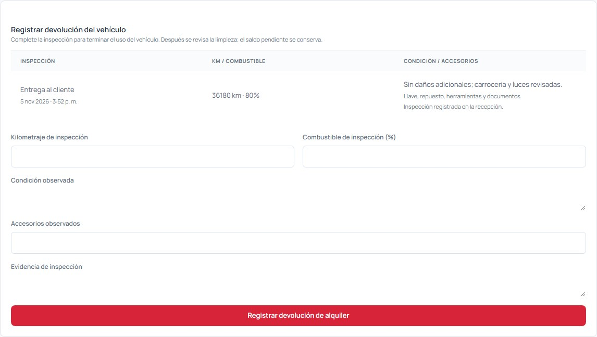

### Qué completar cuando el vehículo regrese realmente
1. Revisar la inspección de **Entrega al cliente** para comparar el estado recibido.
2. Completar **Kilometraje de inspección** y **Combustible de inspección (%)** con la lectura actual.
3. Registrar **Condición observada**, **Accesorios observados** y **Evidencia de inspección**.
4. Pulsar **Registrar devolución de alquiler** una sola vez. Este es el paso que termina el uso del carro por el cliente.
5. Después del guardado, pulsar **Continuar con limpieza y disponibilidad**. También puede volver a **Resumen → Finalizar limpieza**.

### Qué debe cambiar después de una devolución real
- El alquiler pasa de **Alquiler en curso** a **Devuelto · limpieza pendiente**.
- El carro sigue bloqueado hasta revisar su limpieza; todavía no se presenta como listo para otra renta.
- El saldo pendiente continúa pendiente. Una diferencia de combustible o condición se revisa; no crea un cargo automático.

**Para este recorrido de consulta:** no pulsar el botón de guardado. Mostrar el formulario y abrir el caso histórico como indica la página siguiente.

**Para seguir:** volver al expediente del Versa → **Historial de alquileres** → **ALQ-00004 → Abrir alquiler** → **Limpieza**.

<!-- page -->
# 03.4 · Alquiler → Limpieza y finalización

**Cómo se llega para mostrar un caso ya terminado:** expediente del Versa → **Historial de alquileres** → **ALQ-00004 → Abrir alquiler** → **Limpieza**.

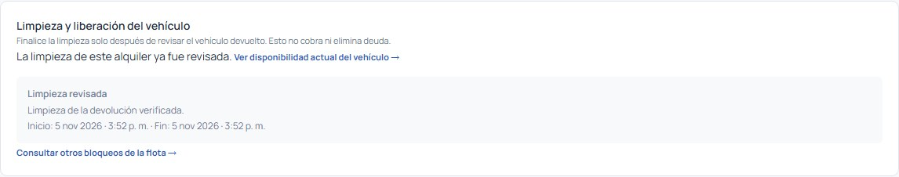

### Qué mostrar en este caso histórico
1. Verificar **ALQ-00004** en la cabecera. No es el alquiler activo ALQ-00006.
2. Mostrar **Limpieza revisada**. Su revisión ya está registrada; no hay otro botón para repetirla.
3. Volver a **Resumen**: el recorrido llega a **Limpieza revisada** y el estado dice **Alquiler finalizado**.

### Qué se hace después de una devolución nueva
1. En el alquiler recién devuelto, abrir **Limpieza**.
2. Completar **Revisión de limpieza y condición para otra renta**.
3. Pulsar **Confirmar limpieza y revisar disponibilidad**.
4. Abrir **Ver disponibilidad actual del vehículo**: solo vuelve a disponible si no tiene otros impedimentos. Las reservas posteriores siguen en la agenda.

**Qué decir:** «Primero recibo e inspecciono el carro; después reviso su limpieza. Son dos acciones visibles. Cobrar se hace por separado y una deuda puede seguir pendiente aunque el carro ya regresó».

**Para seguir:** pulsar **Calendario** en el menú izquierdo. No registrar la devolución actual solo para reproducir una captura del historial.

<!-- page -->
# 04 · Calendario

**Dónde entrar:** menú izquierdo → **Calendario**. Dejar seleccionada la pestaña **Calendario**.

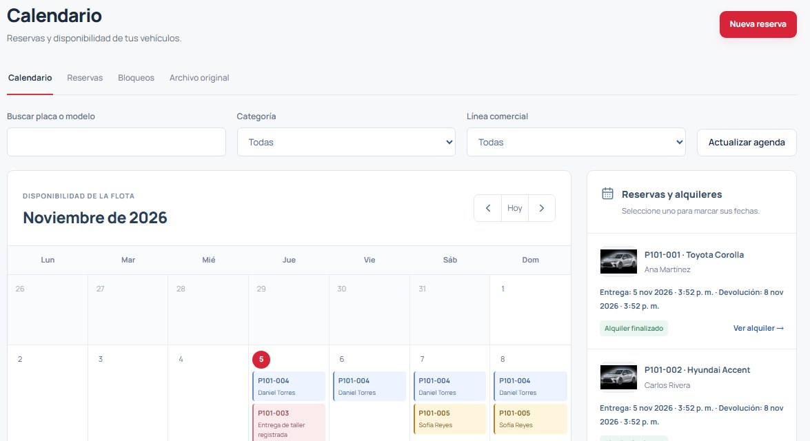

### Qué hacer
1. Mostrar los filtros **Buscar placa o modelo**, **Categoría** y **Línea comercial**.
2. Dejar la búsqueda vacía para ver la flota completa.
3. En el mensual de noviembre de 2026, señalar la operación del Versa y la reserva del Swift.
4. En la lista **Reservas y alquileres**, localizar **Swift P101-005 / Sofía Reyes** y pulsar **Ver reserva →** en su tarjeta. Revisar estado confirmado y fechas del **7 al 11 de noviembre, 09:00**. Pulsar un evento del mensual solo selecciona sus fechas; **Ver reserva →** abre el detalle.
5. Cerrar el detalle. Usar **Mes siguiente** y después **Hoy** para mostrar la navegación.
6. Bajar en la misma pantalla hasta la sección **Planificación Gantt de vehículos**.

### Qué decir
> «Aquí la pregunta es qué vehículo está comprometido y para qué fechas. El calendario no es un registro de pagos: una reserva puede estar confirmada y todavía no tener un cargo emitido».

**Tiene que verse:** los compromisos del mensual y, más abajo, el Gantt de esos mismos vehículos. No cambiar de módulo para buscarlo.

**Para seguir:** permanecer en Calendario y continuar con el Gantt de la siguiente página.

<!-- page -->
# 04.1 · Calendario → Gantt

**Cómo se llega:** en Calendario, desplazar la página hacia abajo, debajo del mensual.

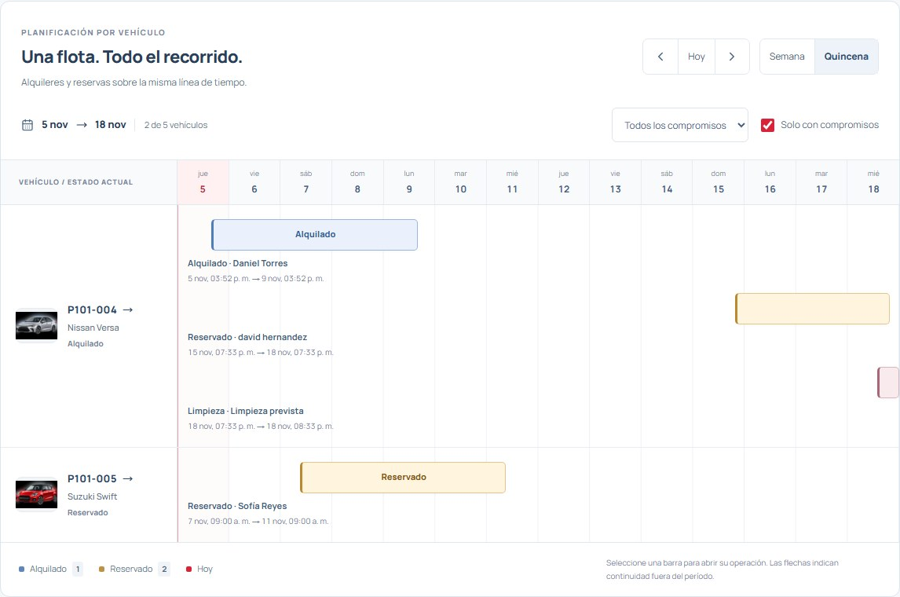

### Qué hacer
1. Con **Solo con compromisos** marcado, localizar las filas del **Versa P101-004** y del **Swift P101-005**.
2. Pulsar la barra del Versa identificada como **Alquilado**. Debe abrir el detalle de **Daniel Torres** y la misma unidad P101-004.
3. Cerrar el detalle.
4. Desmarcar **Solo con compromisos**. Deben incluirse las **5 unidades** de flota, no únicamente las dos comprometidas.
5. En **Estado en el Gantt**, elegir **Reservado** para aislar el Swift.
6. Volver a **Todos** y marcar otra vez **Solo con compromisos**.

### Qué decir
> «El mensual y estas barras son dos vistas de la misma agenda. Al abrir una barra no obtengo una ficha inventada para el gráfico: entro al detalle de la reserva o alquiler que ya está guardado».

**Si se muestra en celular:** la ventana del Gantt es semanal; navegar a la semana de la reserva. Que una barra no esté en la semana visible no significa que se haya perdido.

**Para seguir:** volver a la parte superior y pulsar **Nueva reserva** si se quiere mostrar el formulario. Si no, ir directamente a **Taller** en el menú.

<!-- page -->
# 04.2 · Calendario → Nueva reserva

**Cómo se llega:** Calendario → botón superior **Nueva reserva**.

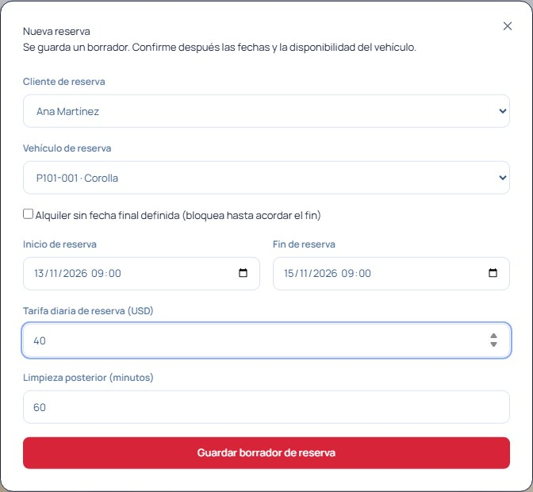

### Qué completar para un ejemplo nuevo
1. **Cliente de reserva:** Ana Martínez.
2. **Vehículo de reserva:** P101-001 · Corolla.
3. Dejar desmarcado **Alquiler sin fecha final definida**.
4. **Inicio:** 13/11/2026, 09:00. **Fin:** 15/11/2026, 09:00.
5. **Tarifa diaria:** 40. **Limpieza posterior:** 60 minutos.

### Si solo se quiere mostrar
Cerrar con **X / Cerrar**. No se crea ninguna reserva ni cambia la disponibilidad.

### Ejemplo para guardar
Pulsar **Guardar borrador de reserva**. En el detalle que se abre, revisar el precio previsto de **$80** y pulsar **Confirmar reserva**. Anotar el nuevo ALQ; no confundirlo con el histórico ALQ-00001 de Ana.

Cerrar el detalle y buscar el Corolla en el mensual y el Gantt del día 13. La clasificación de flota pasa a **2 disponibles, 1 alquilado y 2 reservados** si no hubo otros cambios. No entra dinero ni se crea un cargo por confirmar la reserva.

**Para seguir:** pulsar **Taller** en el menú izquierdo.

<!-- page -->
# 05 · Taller

**Dónde entrar:** menú izquierdo → **Taller**.

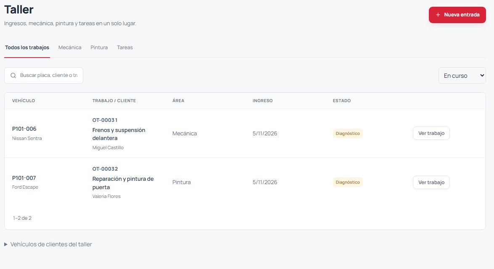

### Qué hacer
1. Dejar **Todos los trabajos** y **Estado de los trabajos: En curso**. Deben aparecer **Sentra P101-006 / OT-00031** y **Escape P101-007 / OT-00032**.
2. Pulsar **Mecánica**: mostrar el Sentra. Pulsar **Pintura**: mostrar el Escape. Volver a **Todos los trabajos**.
3. En **Estado de los trabajos**, elegir **Entregados**. Mostrar los tres mantenimientos de Corolla, Accent y Rio.
4. Volver a **En curso** y buscar **P101-006** si se quiere aislar el Sentra.
5. En su fila, pulsar **Ver trabajo** o el enlace **OT-00031**. No pulsar la placa si se quiere entrar al trabajo específico: la placa abre el expediente del vehículo.

### Qué decir
> «Taller reúne las áreas y el estado de los trabajos. Voy a abrir la OT-31 que ya vimos en la ficha de Miguel. La placa identifica al vehículo; el folio identifica esta visita al taller».

**Para mostrar los otros dos vehículos registrados:** desplegar **Vehículos de clientes del taller** en la parte inferior. Allí están Sentra y Escape sin incorporarlos a la flota de alquiler.

**Para seguir:** abrir el trabajo OT-31 del Sentra y recorrer sus pestañas.

<!-- page -->
# 05.1 · Taller → Trabajo del Sentra

**Cómo se llega:** Taller → fila del Sentra → **Ver trabajo**. Verificar **OT-00031 / P101-006** en la cabecera.

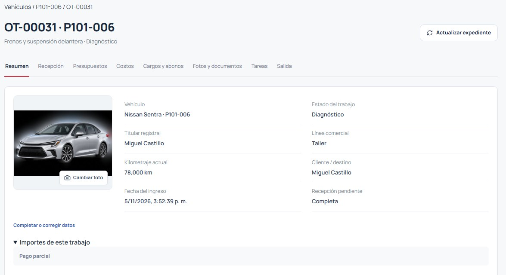

### Qué tocar, de izquierda a derecha

| Pestaña | Qué mostrar con este ejemplo |
| --- | --- |
| Resumen | Cliente, placa y trabajo «Frenos y suspensión delantera». |
| Recepción | Inspección registrada: kilometraje, combustible, condición y accesorios. |
| Presupuestos | Versiones de $520 y $600; la revisión de $600 está aprobada. |
| Costos | Materiales por $180, con su vínculo al gasto original. |
| Cargos y abonos | Cargo $600, aplicado $200 y saldo $400. |
| Fotos y documentos | Soportes de este trabajo, no archivos de otro ingreso. |
| Tareas | Diagnóstico finalizado y tarea de instalación en proceso. |
| Salida | Revisión de pendientes antes de una entrega. No confirmarla durante el recorrido de consulta. |

### Qué decir
> «Todo esto pertenece a la misma OT-31. No estoy copiando $600 y $200 de una pantalla a otra: cada pestaña consulta la parte correspondiente de este trabajo».

**Para seguir:** volver a **Taller** desde el menú y abrir **Tareas**, o pasar a **Presupuestos** después del detalle siguiente.

<!-- page -->
# 05.2 · Taller → Tareas y entregados

### Primero: mostrar las tareas del Sentra
1. Pulsar **Taller** en el menú y después la pestaña **Tareas**.
2. En **Trabajo para las tareas**, seleccionar el trabajo del **Sentra P101-006**.
3. Señalar el diagnóstico finalizado y **Instalar kit de frenos y comprobar suspensión**, en proceso.
4. Mostrar **Finalizar tarea**, pero no pulsarlo si se desea conservar el trabajo tal como está.
5. Señalar que se puede crear una tarea con **Nueva tarea**, **Responsable de la nueva tarea** y **Crear tarea**. Para la exposición no es necesario inventar otro responsable ni otra tarea.

### Después: mostrar una entrega que ya existe
1. Volver a **Todos los trabajos** y elegir **Entregados**.
2. Abrir **OT-00028**, el mantenimiento del Corolla.
3. Ir a **Salida** y mostrar el acta existente. Sus tareas y costos se revisaron antes de la entrega.

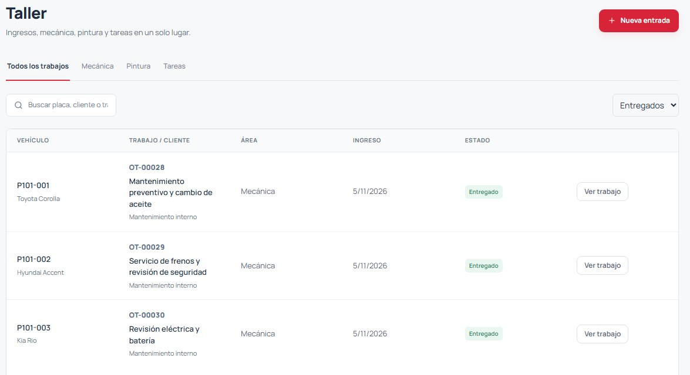

### Qué decir
> «Puedo mostrar tanto un trabajo en proceso como uno ya entregado. Finalizar una tarea no cobra dinero y no sustituye la entrega revisada del vehículo».

**Para seguir:** pulsar **Presupuestos** en el menú izquierdo. No dejar un formulario de entrega abierto.

<!-- page -->
# 06 · Presupuestos

**Dónde entrar:** menú izquierdo → **Presupuestos**.

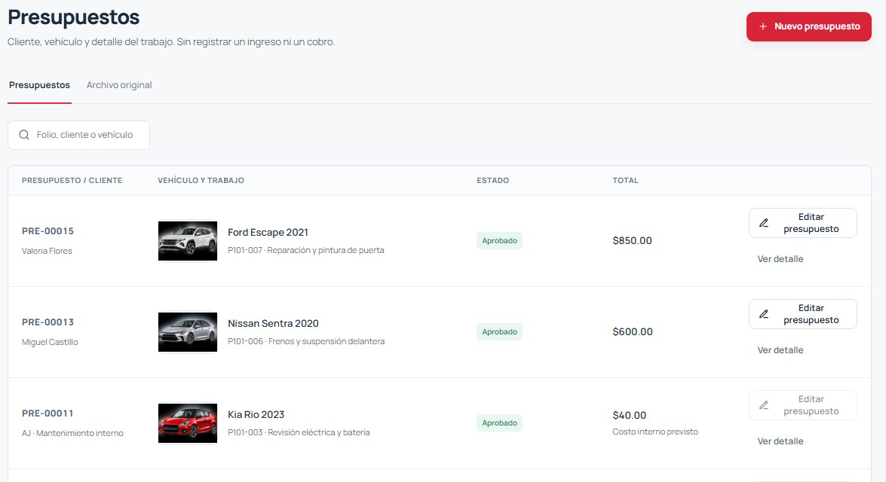

### Qué hacer
1. Mostrar que hay **5 trabajos con presupuesto**: tres internos y los dos trabajos abiertos. El listado presenta la última versión de cada trabajo, no todas las versiones sumadas.
2. Ubicar el **Sentra P101-006**, con la última revisión **Aprobado** y total **$600**.
3. Ubicar el **Escape P101-007**, con su última revisión de **$850**. Consultar el estado visible: ya fue aprobada en la revisión de referencia.
4. En el buscador **Buscar presupuesto**, escribir **P101-006**.
5. En esa fila, pulsar **Ver detalle**. No empezar por **Nuevo presupuesto**, porque el Sentra ya tiene uno.

### Qué decir
> «Esta lista permite encontrar los presupuestos por cliente, placa o folio. Ahora voy a mostrar la revisión del Sentra que también aparecía dentro de su trabajo de taller».

**Tiene que verse:** PRE-00013, versión 2, aprobada por $600, relacionada con OT-31. Si se abre otra revisión, comprobar el selector de versiones antes de afirmar cuál es la vigente.

**Para seguir:** permanecer en el detalle del Sentra y continuar con la siguiente página.

<!-- page -->
# 06.1 · Presupuestos → Detalle y versiones

**Cómo se llega:** Presupuestos → Sentra P101-006 → **Ver detalle**.

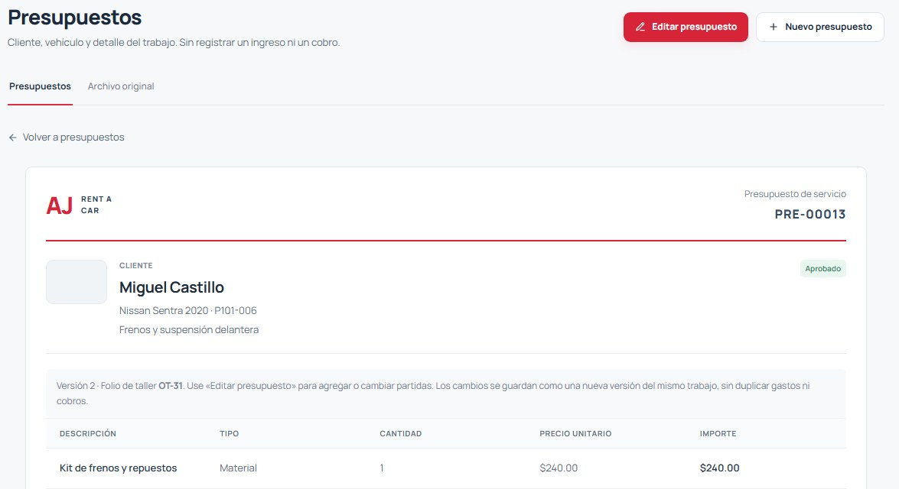

### Qué hacer
1. Mostrar cliente **Miguel Castillo**, vehículo **P101-006**, **PRE-00013** y estado **Aprobado**.
2. Leer las partidas: repuestos **$240**, mano de obra **2 × $120 = $240** y alineación/verificación **$120**. Total **$600**.
3. Desplegar **Versiones y costos internos**.
4. En **Versión del presupuesto**, seleccionar la versión 1 de **$520**. Después volver a la versión 2 de **$600**.
5. Mostrar **Seguimiento de este trabajo**: costos $180, cargos $600, aplicado $200 y saldo $400.
6. Señalar **Ver cargos y cobros** y **Ver libro diario** como enlaces al mismo trabajo. Para no saltar todavía el orden del menú, permanecer en Presupuestos.

### Qué decir
> «La revisión reemplaza el alcance comercial anterior, no lo suma. El total vigente es $600, no $520 más $600. Desde este documento puedo llegar a los cobros y al diario del mismo folio».

**Opcional:** **Descargar PDF** entrega el documento de esta versión. No es una nueva venta ni otro cobro.

**Para seguir:** usar **Volver a presupuestos**, buscar el Escape y abrir su detalle para mostrar la edición; o pasar a **Cargos y cobros** si no se hará ese ejemplo.

<!-- page -->
# 06.2 · Presupuestos → Editar el Escape

**Cómo se llega:** Presupuestos → buscar **P101-007** → **Ver detalle** → **Editar presupuesto**.

### Qué hacer dentro del editor
1. Comprobar que ya aparecen **Pintura y materiales: $400** y **Preparación, reparación y acabado: 3 × $150 = $450**.
2. Pulsar **Agregar mano de obra**.
3. En **Descripción 3**, escribir **Revisión final y acabado**; en **Cantidad 3**, **1**; en **Precio unitario 3**, **50**.
4. Verificar que el total cambia de **$850 a $900** en el editor.
5. En **Observaciones / motivo del cambio**, escribir **Se incorpora revisión final y se conserva el alcance completo del trabajo**.

### Qué decir
> «Puedo ampliar el alcance sin perder las partidas anteriores. El editor ya muestra $900, pero todavía no se ha guardado ni cobrado ese importe».

### Elegir cómo cerrar el ejemplo
- **Solo mostrar:** pulsar **Cancelar**. La revisión guardada continúa en $850.
- **Ejemplo para guardar:** pulsar **Guardar presupuesto**. Se crea una versión nueva en borrador de la misma OT-32. Anotar el nuevo PRE.
- **Para mostrar aprobación:** en la nueva versión, pulsar **Aprobar presupuesto**; persona **Valeria Flores**; confirmación **Autoriza alcance completo por $900**; pulsar **Confirmar aprobación**.

**Resultado de guardar y aprobar:** hay un presupuesto de $900 autorizado, pero **todavía no hay cargo ni dinero nuevo**. No pulsar **Crear cargo del presupuesto** en esta variante del recorrido; así la comparación de caja posterior sigue siendo válida.

**Para seguir:** pulsar **Cargos y cobros** en el menú izquierdo.

<!-- page -->
# 07 · Cargos y cobros

**Dónde entrar:** menú izquierdo → **Cargos y cobros**.

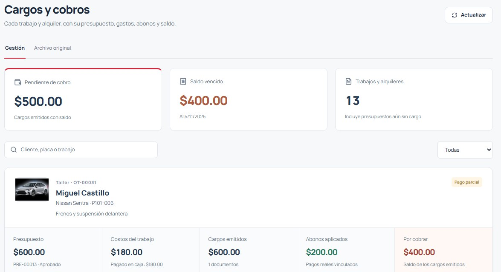

### Qué hacer
1. Señalar **Pendiente de cobro: $500**. El Sentra aporta $400 y el Versa $100.
2. En **Buscar operación de cobro**, escribir **P101-006**.
3. Leer la tarjeta de Miguel: **Presupuesto $600**, **Costos del trabajo $180**, **Cargos emitidos $600**, **Abonos aplicados $200**, **Por cobrar $400**.
4. Desplegar **Ver cargos, abonos y gastos**. Señalar **CAR-00009** y la aplicación del recibo de $200.
5. Borrar la búsqueda y escribir **P101-007**. Mostrar **Sin cargo** y **$100 de anticipo disponible**. Si se guardó la edición anterior, el presupuesto podrá mostrar $900; eso no significa que ya haya un cargo por $900.
6. Volver a buscar **P101-006** y pulsar **Registrar abono** en su tarjeta.

### Qué decir
> «Aquí veo lo que se debe por operación. En el Sentra ya existe una deuda documentada; en el Escape hay dinero recibido como anticipo, pero el presupuesto no se convirtió automáticamente en deuda».

**Para seguir:** completar o mostrar el formulario de abono de la página siguiente. No volver a crear el cargo de $600 que el Sentra ya tiene.

<!-- page -->
# 07.1 · Cargos y cobros → Registrar abono

**Cómo se llega:** tarjeta del **Sentra P101-006** → **Registrar abono**. Cliente y OT deben venir precargados.

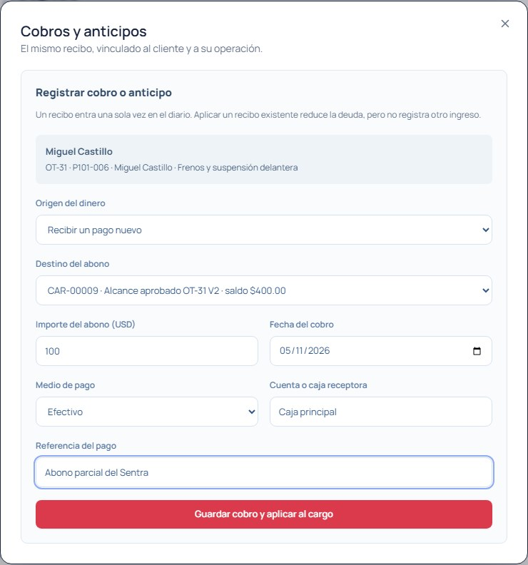

### Qué completar para el ejemplo de $100
1. En el contexto superior, comprobar **Miguel Castillo / OT-31 / P101-006**.
2. **Origen del dinero:** dejar **Recibir un pago nuevo**.
3. **Destino del abono:** seleccionar **CAR-00009**, con saldo **$400**.
4. **Importe del abono (USD): 100**. **Fecha del cobro:** la fecha del día de la exposición.
5. **Medio de pago:** Efectivo. **Cuenta o caja receptora:** **Caja principal**.
6. **Referencia del pago:** **Abono parcial del Sentra**.

### Cómo cerrar
- **Solo mostrar:** pulsar **X / Cerrar**. El saldo sigue en $400.
- **Ejemplo para guardar:** pulsar **Guardar cobro y aplicar al cargo** una sola vez. El Sentra debe quedar en **$300**; la cartera global baja a **$400**. Se crea un recibo nuevo de $100.

**Qué decir:** «Este guardado sí recibe dinero: entran $100 y, al aplicarse al cargo correcto, la deuda baja de $400 a $300».

**Para seguir:** anotar el nuevo REC si se guardó. Pulsar **Libro diario** en el menú para comprobar el movimiento; no registrar esos mismos $100 otra vez desde allí.

<!-- page -->
# 08 · Libro diario

**Dónde entrar:** menú izquierdo → **Libro diario**.

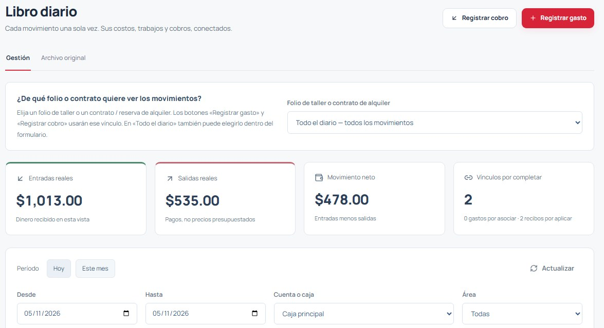

### Qué tocar para ver el conjunto completo
1. En **Folio de taller o contrato de alquiler**, elegir **Todo el diario — todos los movimientos**.
2. Elegir **Caja principal** en **Cuenta o caja**.
3. Para revisar la carga original, fijar **Desde y Hasta: 05/11/2026**. Si se guardó un cobro en otra fecha, ampliar **Hasta** para incluirlo. **Hoy** sirve si ambos registros corresponden al día actual.
4. Dejar la búsqueda vacía, **Área: Todas** y pestaña **Todos**.
5. Leer entradas, salidas, movimiento neto y saldo al final del período.

| Qué se ejecutó hasta aquí | Entradas | Salidas | Neto | Caja final |
| --- | --- | --- | --- | --- |
| Solo se abrieron y cerraron formularios | $1,013 | $535 | $478 | $1,478 |
| Se guardó el abono nuevo de $100 del Sentra | $1,113 | $535 | $578 | $1,578 |

### Qué decir
> «Este registro muestra dinero que entró o salió. Si guardé el abono anterior, aquí debe existir una entrada nueva de $100, no otra entrada por los $600 del presupuesto. Voy a buscarla y volver al folio desde su vínculo».

**Para seguir:** si se guardó el abono, buscar **Abono parcial del Sentra**, abrir su enlace a OT-31 y comprobar saldo $300 en **Cargos y abonos**. Volver a Libro diario para la página siguiente.

<!-- page -->
# 08.1 · Libro diario → Registrar cobro

**Cómo se llega:** Libro diario, vista de todo el diario → **Registrar cobro**.

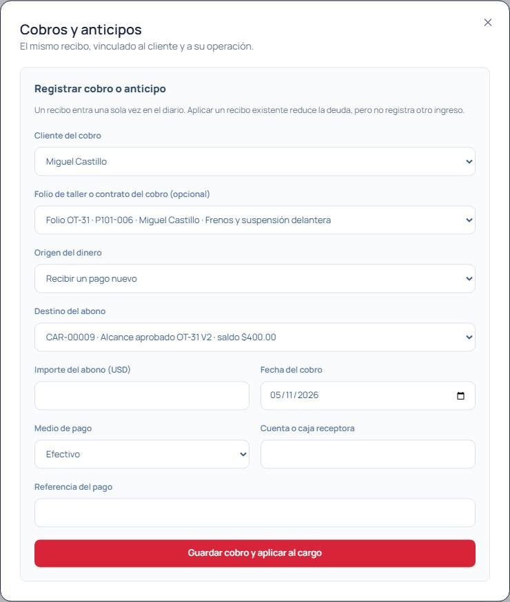

### Qué hacer para mostrar que sí carga el folio
1. Esperar que termine **Consultando cargos y recibos…**.
2. En **Cliente del cobro**, elegir **Miguel Castillo**.
3. En **Folio de taller o contrato del cobro (opcional)**, elegir **Folio OT-31 · P101-006 · Miguel Castillo**. Antes de elegir cliente, este listado puede estar vacío.
4. En **Destino del abono**, elegir **CAR-00009**. Debe mostrar $400 pendientes si no se hizo el abono anterior, o $300 si ya se guardó.
5. Mostrar **Origen del dinero**: un pago nuevo recibe dinero; usar un REC existente aplica dinero que ya entró antes.
6. **Cerrar sin guardar**: esta pantalla explica la segunda puerta de entrada al mismo formulario. No repetir aquí el cobro ya guardado desde Cargos y cobros.

### Qué decir
> «Si llego desde todo el diario, primero elijo al cliente y después el folio. Si llego desde la tarjeta del Sentra, ese contexto ya viene seleccionado. No son dos sistemas de cobro distintos».

**Para seguir:** permanecer en Libro diario, borrar búsquedas y buscar **Un comprobante de materiales** para revisar el gasto compartido.

<!-- page -->
# 08.2 · Libro diario → Comprobante compartido

**Cómo se llega:** Libro diario → buscador **Buscar en el diario** → escribir **Un comprobante de materiales**.

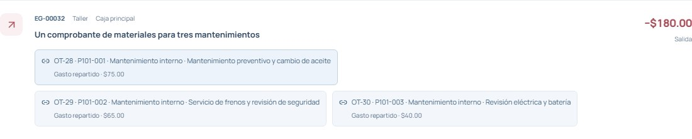

### Qué hacer
1. Mostrar la ficha **Un comprobante de materiales para tres mantenimientos**.
2. Señalar el importe de salida original: **$180**, una sola vez.
3. Leer los vínculos: **OT-28 / Corolla: $75**, **OT-29 / Accent: $65** y **OT-30 / Rio: $40**.
4. Pulsar el vínculo de **OT-28**. Debe abrir el mantenimiento del Corolla en la sección de costos.
5. Comprobar que a ese trabajo le corresponden **$75**, no otros $180 completos.
6. Seguir **Ver gasto original** o volver a Libro diario para mostrar que se trata del mismo comprobante.

### Qué decir
> «Este pago se distribuyó entre tres trabajos, pero el dinero salió una sola vez. Los vínculos explican el reparto: $75 más $65 más $40 son los mismos $180 del comprobante».

**No guardar otro gasto para demostrar el vínculo.** Los enlaces permiten consultar lo que ya está registrado.

**Para seguir:** volver a Libro diario y mostrar el formulario de gasto de la página siguiente, o pasar al cierre en Inicio si no se harán más ejemplos.

<!-- page -->
# 08.3 · Libro diario → Registrar gasto

**Cómo se llega:** en Libro diario, borrar la búsqueda → seleccionar **OT-31 / Sentra** en el selector de folio → pulsar **Registrar gasto**.

### Qué completar para un gasto nuevo de $15

| Campo | Valor |
| --- | --- |
| Concepto | Consumibles de revisión del Sentra |
| Importe (USD) | 15 |
| Fecha efectiva | Fecha del día de la exposición |
| Vincular gasto a | Folio de taller |
| Trabajo / folio | OT-31 · P101-006 · Miguel Castillo |
| Categoría | Materiales |
| Medio de pago | Efectivo |
| Cuenta o caja | **Caja principal** |
| Referencia del soporte | CONSUMIBLES-01 |

### Cómo cerrar
- **Solo mostrar:** pulsar **Cancelar**.
- **Ejemplo para guardar:** pulsar **Guardar registro** una sola vez. Aparece una salida nueva de **$15**. Abrir su vínculo para comprobarla en **OT-31 → Costos**.
- Si se quiere resolver la disposición comercial: en el nuevo costo, desplegar **Clasificar costo**, elegir **Absorbido**, sin alcance comercial, motivo **Consumible asumido por AJ, sin cargo adicional al cliente**, y pulsar **Guardar disposición**.

**Qué debe cambiar:** costos pagados del Sentra de $180 a **$195** y salidas globales de $535 a **$550**. Su deuda **no aumenta** por registrar este gasto.

**Si antes se guardó el abono de $100:** el Sentra mantiene saldo **$300**, la cartera global **$400** y la caja final pasa de $1,578 a **$1,563**. Si solo se guardó el gasto, sin ese abono, la caja es **$1,463** y la cartera sigue en $500.

**Para seguir:** pulsar **Inicio** para cerrar el recorrido con los valores actualizados.

<!-- page -->
# Cierre · Volver a Inicio

**Dónde entrar:** menú izquierdo → **Inicio**. Si falta refrescar una vista, usar **Actualizar datos** o recargar una vez; no repetir un guardado ya confirmado.

### Qué señalar ahora
1. **Pendiente de cobro:** si se guardó el abono de $100, debe verse **$400**, no los $500 iniciales.
2. **Entradas y salidas del mes:** con abono $100 y gasto $15 guardados, entradas **$1,113**, salidas **$550** y neto **$563**.
3. **Estado de la flota:** si se confirmó la reserva del Corolla, deben verse **2 disponibles, 1 alquilado y 2 reservados**. Si solo se mostró el formulario, continúa en 3, 1 y 1.
4. Si se creó una ficha nueva, Clientes debe mostrar **una más** que al comenzar. Si se canceló el alta, el total no cambia.
5. Si se guardó la revisión del Escape, mostrar después su nueva versión de **$900**. No llamarla cargo ni cobro si no se emitió un CAR.

### Resumen de los ejemplos financieros de este recorrido

| Acciones guardadas | Cartera global | Caja final de Caja principal |
| --- | --- | --- |
| Ninguna | $500 | $1,478 |
| Solo abono del Sentra de $100 | $400 | $1,578 |
| Solo gasto del Sentra de $15 | $500 | $1,463 |
| Abono $100 y gasto $15 | $400 | $1,563 |

### Qué decir para terminar
> «Recorrí el sistema en el orden del menú. Seguí el mismo cliente, vehículo y folio entre las pantallas. Cuando recibí dinero, cambió caja y bajó la deuda; cuando registré un gasto, cambió caja y el costo, pero no se inventó otra deuda del cliente. La reserva cambió la agenda, no el dinero».

**Los ejemplos no se guardaron para preparar esta guía; se conservaron los registros existentes.** Los cuadros financieros del cierre suponen que en Vehículos solo se consultó el cobro del Versa. Si se guardó también ese pago, sumar sus $100 a las entradas y restarlos de la cartera. El Libro diario es un registro de caja, no contabilidad completa de partida doble.
